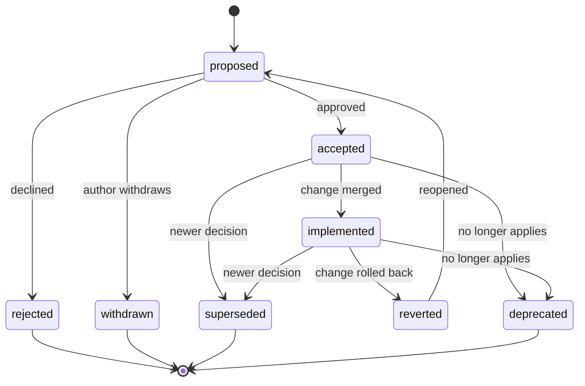
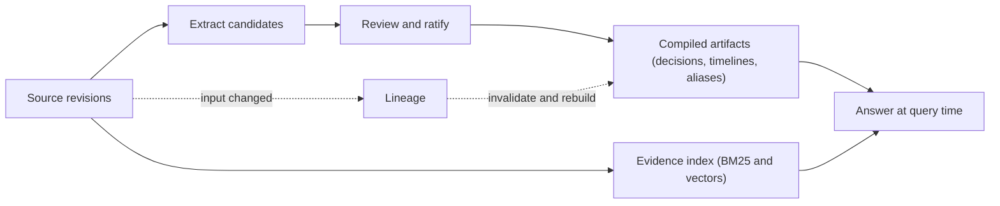
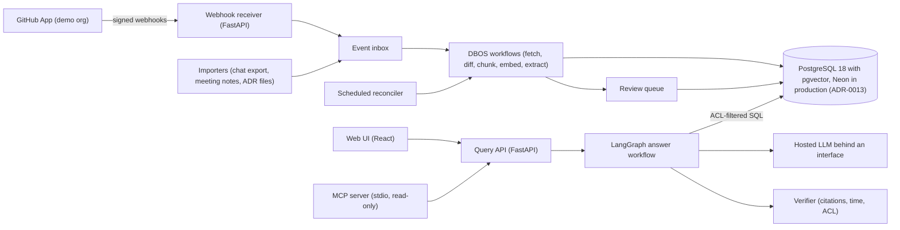
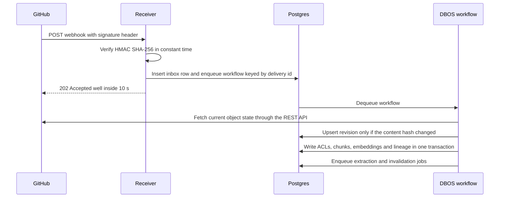
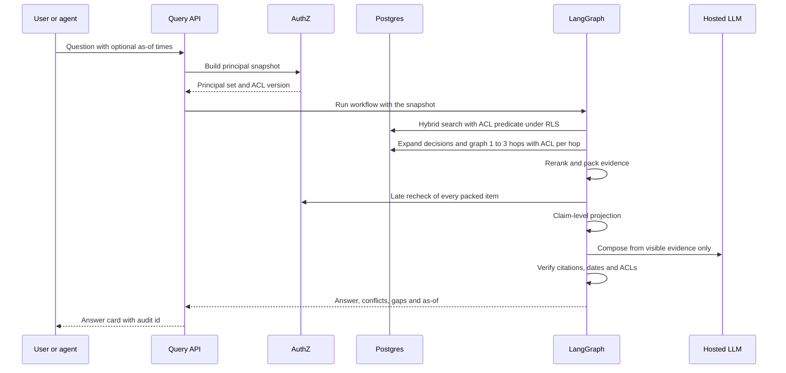
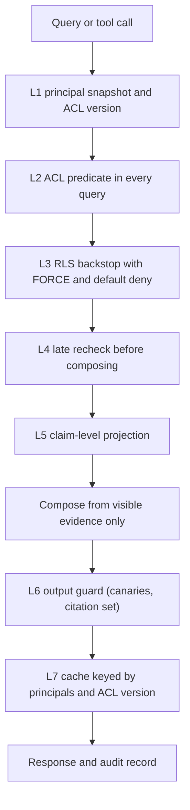

# Company Brain brainstorm: Cairn, decision memory for engineering teams and their agents

> Prepared: 27 Oct 2026. Status: brainstorm, not a PRD. Nothing described here is implemented or measured yet.
> Inputs: the original Company Brain research doc (pasted in chat) and a fresh research pass over papers, docs, repositories and vendor material, listed in [References](#21-references).
> Assumption: Built independently in this repo; baselines implemented fresh.

Evidence legend:

- `[R#]` cites a row in [References](#21-references). Its Type column says whether it is a paper, docs, an OSS repo, a vendor page or a thesis.
- (vendor-reported): a number a vendor published about its own product or survey. Not independently checked.
- Illustrative: mock data or example output. All people, companies and records in examples are fictional.
- Proposed target: an acceptance target we set. Not a result.
- Estimate: a planning number. Not measured.
- Verify: not confirmed in this research pass. Check before relying on it.

## How to read this

If you have five minutes, read section 1. If you are writing the PRD, read sections 1, 4 to 8, 11, 16 and 19. If you are building, read sections 9 to 14 and the spike plans in Appendix C. The companion [development plan](development_plan.md) turns section 18 into phase-wise checklists.

The user delegated every decision in this document. Decisions D1 to D20 are final for the MVP, and each one carries a "revisit if" condition so it can be reopened on evidence rather than opinion.

Contents:

- [1. TL;DR and decision log](#1-tldr-and-decision-log)
- [2. What the research says, and what it does not prove](#2-what-the-research-says-and-what-it-does-not-prove)
- [3. Stress-test of the original research doc](#3-stress-test-of-the-original-research-doc)
- [4. Problem, users, and jobs to be done](#4-problem-users-and-jobs-to-be-done)
- [5. Choosing the wedge](#5-choosing-the-wedge)
- [6. Product concept](#6-product-concept)
- [7. Feature brainstorm, prioritization, and MVP](#7-feature-brainstorm-prioritization-and-mvp)
- [8. Journeys, UX concepts, and success metrics](#8-journeys-ux-concepts-and-success-metrics)
- [9. Architecture and stack decisions](#9-architecture-and-stack-decisions)
- [10. Data model and temporal semantics](#10-data-model-and-temporal-semantics)
- [11. Permission model](#11-permission-model)
- [12. Ingestion and sync](#12-ingestion-and-sync)
- [13. Extraction, retrieval, and answering](#13-extraction-retrieval-and-answering)
- [14. Agent interface (MCP)](#14-agent-interface-mcp)
- [15. Threat model](#15-threat-model)
- [16. Evaluation plan](#16-evaluation-plan)
- [17. Synthetic company: Kestrel Pay](#17-synthetic-company-kestrel-pay)
- [18. Roadmap: 27 Oct to 20 Nov 2026](#18-roadmap-27-oct-to-20-nov-2026)
- [19. Risks and open questions for the PRD](#19-risks-and-open-questions-for-the-prd)
- [20. Portfolio packaging and interview prep](#20-portfolio-packaging-and-interview-prep)
- [21. References](#21-references)
- [Appendix A. Glossary](#appendix-a-glossary)
- [Appendix B. Example decision record](#appendix-b-example-decision-record)
- [Appendix C. Spike plans](#appendix-c-spike-plans)

## 1. TL;DR and decision log

- Build Cairn: decision memory for engineering teams and their coding agents. It answers "why is it like this, since when, who decided, and is that still true" with cited evidence, using only sources the asker can open.
- The category is real and crowded. Slite, Onyx, Glean, Unblocked, Memory Store and Atlassian all sell some form of context layer [R1][R2][R6][R7][R8][R10][R11]. Cairn competes on what none of them publish: decisions as versioned, bitemporal records with tested permission behavior.
- The wedge was chosen by weighted scoring (section 5). Engineering decision memory anchored to code scores 4.35 of 5, ahead of incident memory (3.60) and an onboarding brain (3.20).
- The core object is a Decision Record aligned with MADR [R24], with separate lifecycle and verification axes. AI proposes, humans ratify, and contradictions are never auto-resolved.
- One database: PostgreSQL 18 with pgvector and native full-text search holds revisions, ACLs, chunks, claims, bitemporal decisions and audit, on Neon in production [R28][R31][R35] (ADR-0013). DBOS replaces Celery and Redis [R40]. Shallow graph traversals run in SQL, so no graph database is needed.
- Permissions are enforced in seven layers, with row-level security as a backstop only [R29]. The hardest case is derived content: a claim is visible only if one complete set of its supporting evidence is visible.
- Time has two axes: when something was true and when Cairn recorded it [R27]. That makes "what did we believe on 10 March" answerable, and it stops as-of answers from citing the future.
- Agents get a read-only MCP server over stdio with five tools [R43]. Cairn adds no outbound channel to the agent path, which keeps it out of the lethal trifecta [R47][R48].
- Evaluation uses a synthetic company with planted permission canaries and time twists, real ADR, KEP and PEP lifecycles, and an EnterpriseRAG-Bench subset [R20][R22][R25][R26]. Proposed targets include 0 observed leaks and revocation p95 <= 60 s.
- The MVP ships by 20 Nov 2026 in seven phases, with spikes first (section 18). The permission matrix, the revocation test, as-of correctness and the published eval table are never cut.

Decision log (final for the MVP):

| ID | Decision | Revisit if | Section |
|---|---|---|---|
| D1 | Wedge: engineering decision memory anchored to code. Scores: A 4.35, B code-anchored why 3.80, C incident memory 3.60, D onboarding brain 3.20, E agent decision-trace ledger 2.90, F deal-desk precedent 2.75. | Five target users do not rank "why is this like this" in their top three pains, or S4 extraction precision stays below 0.7 | [5](#5-choosing-the-wedge) |
| D2 | Working name "Cairn"; retire "ContextOS" (generic category term [R2]); reversible; check name collisions. | A name search finds a conflicting developer tool or trademark (Verify) | [6](#6-product-concept) |
| D3 | Core object: Decision Record (MADR-aligned) with two status axes. Lifecycle: proposed, accepted, implemented, superseded, deprecated, rejected, withdrawn, reverted. Verification: candidate, human-verified, disputed, unsupported. | Reviewers cannot classify more than 10% of real C2 decisions with these states | [6](#6-product-concept) |
| D4 | Never auto-resolve contradictions. Show both sides with dates and trust tiers (T1 merged code or accepted ADR, T2 approved review or meeting decision, T3 design doc, T4 ticket, T5 chat, T6 AI inference which is never evidence). Humans resolve. | The review queue grows faster than reviewers clear it for two weeks; then add suggested resolutions, still human-confirmed | [6](#6-product-concept) |
| D5 | Store: plain PostgreSQL 18 with pgvector, on Neon in production and a pinned `pgvector/pgvector` image locally (ADR-0013). Holds revisions, ACLs, chunks, entities, claims, bitemporal decisions, lineage, audit. | S1 or S2 shows ACL-filtered retrieval cannot meet recall and latency targets inside Postgres, or Neon's free limits (1 GB storage, 100 CU-hours a month) cannot hold the demo corpus | [9](#9-architecture-and-stack-decisions) |
| D6 | Lexical: PostgreSQL native full-text search (GIN index, `websearch_to_tsquery`, `ts_rank_cd`); no ParadeDB, which is AGPL-3.0 and retired from Neon [R33][R35] (ADR-0013). | Lexical recall on C1 dev is too low for B1, or FTS misbehaves under RLS in S2; then reconsider BM25 outside Neon | [9](#9-architecture-and-stack-decisions) |
| D7 | Vector: pgvector HNSW with iterative scans, on Neon (ADR-0013). Final ACL-filter strategy chosen by spike S1. | Filtered recall@10 falls below 0.95 of exact search at 5% selectivity, or the HNSW index does not fit Neon's 1 GB storage | [16](#16-evaluation-plan) |
| D8 | Graph: Postgres node/edge tables + recursive CTEs (1-3 hops, ACL check per hop). Graphiti is an optional baseline only. | Questions need more than 3 hops, or graph expansion exceeds 300 ms p95 on C1 | [9](#9-architecture-and-stack-decisions) |
| D9 | Temporal: valid_period + recorded_period tstzrange with GiST EXCLUDE (decision_id WITH =, valid_period WITH &&, recorded_period WITH &&). Use PG18 WITHOUT OVERLAPS / PERIOD for single-dimension tables. | Corrections and backdating make the write path error-prone; then evaluate XTDB [R39] | [10](#10-data-model-and-temporal-semantics) |
| D10 | Jobs: DBOS (MIT) durable workflows and queues. No Celery or Redis. | DBOS cannot express ACL-first priority, or ingestion stays below 50 events/s (Estimate) | [12](#12-ingestion-and-sync) |
| D11 | AuthZ: mirrored source ACLs + time-aware memberships. Layered enforcement L1-L7 + audit. OpenFGA later. | More than two sources with nested group semantics are added; then model them in OpenFGA [R41] | [11](#11-permission-model) |
| D12 | Claim-level projection: a claim is visible iff one full support set is visible. Precomputed summaries are shown only if all inputs are visible, otherwise regenerated. No hidden counts. | Regeneration pushes cost per query over budget, or testers find partial answers misleading | [11](#11-permission-model) |
| D13 | MVP sources: GitHub App on a demo org, repo Markdown/ADRs, Slack-export-format chat import, meeting-notes import. No DMs. | S5 shows GitHub permission events miss changes; then add scheduled permission polling | [12](#12-ingestion-and-sync) |
| D14 | One bounded LangGraph workflow: analyze, plan, retrieve, expand, rerank, compose, verify. | An ablation shows a specialist sub-agent adds more than 5 points on a C1 metric | [13](#13-extraction-retrieval-and-answering) |
| D15 | Read-only MCP over stdio with 5 tools. HTTP + OAuth 2.1 later. | The demo needs a remote client; then implement the HTTP authorization spec in full [R43] | [14](#14-agent-interface-mcp) |
| D16 | Models behind provider interfaces. Cloudflare Workers AI embeddings and rerank (chosen in S3), and a free Workers AI answer model by default; Anthropic and OpenAI optional with the user's key (ADR-0015). Judge from a different model family, human-calibrated. | Workers AI misses the latency target, or the free daily neuron allowance (10,000) cannot cover the evaluation plan; then add a paid provider | [16](#16-evaluation-plan) |
| D17 | Eval: C1 synthetic DecisionBench, C2 real ADR/KEP/PEP lifecycles, C3 EnterpriseRAG-Bench subset. B0-B3 + ablations. Canary leak matrix. ACL-filtered vector study. | Judge agreement with human labels is below 0.8 | [16](#16-evaluation-plan) |
| D18 | Docker Compose profiles core/obs/experiments/freetier (freetier emulates the Render free limits of 512 MB and 0.1 CPU; RAM is measured in Phase 0). Demo on Cloudflare Pages + Render free + Neon free, or local + video (ADR-0014). | A free-plan limit blocks the demo (Verify), the freetier profile exceeds 512 MB, or the core profile needs more than 6 GB | [9](#9-architecture-and-stack-decisions) |
| D19 | Frontend: React + TypeScript + Vite + TanStack Query. | Server-rendered pages would cover every P0 screen with less work | [8](#8-journeys-ux-concepts-and-success-metrics) |
| D20 | Synthetic + public data only. Dogfood Cairn's own ADRs. | Not for the MVP; real company data needs a separate privacy review | [17](#17-synthetic-company-kestrel-pay) |

## 2. What the research says, and what it does not prove

Vendor material describes intent and self-reported results. Papers describe the authors' setups. Docs describe behavior we can test ourselves. The References table grades each source.

Definitions:

- Company Brain: a persistent context layer that gathers knowledge from wherever a company creates it and makes it usable by people and agents. Its real job is capturing the why behind decisions, not only fetching documents. It splits from a personal brain on permissions, governance, conflicting sources and shared trust [R1].
- Context layer: the tier between raw sources and the model that decides what reaches the context window. It has six stages: sources, ingestion, permission resolution, conflict and freshness resolution, an interface (usually MCP) and evaluation. Permissions, conflicts and evaluation are the stages teams skip most [R2].
- Decision traces: exception logic, precedent, cross-system synthesis and approvals that happen outside systems. The path starts human-in-the-loop, and captured traces become precedent [R3].
- LLM wiki: an LLM maintains a persistent, interlinked wiki over immutable raw sources and flags contradictions as new sources arrive [R4].
- Origin: Y Combinator's Summer 2026 Request for Startups includes "Company Brain" by Tom Blomfield. It cites GBrain and says the category is not company search or a chatbot bolted onto a wiki (as summarized by Slite [R1]).

Landscape:

| Product | What it is | Strength to learn from | Gap Cairn targets |
|---|---|---|---|
| Glean [R11] | Permission-aware enterprise search and assistant across apps (not re-fetched in this pass) | Cross-app search experience | Decision lifecycle and as-of history are not its published focus |
| Onyx [R8][R9] | Open-source context layer; Community Edition is MIT, 50+ connectors, MCP server with the user's access | Connector and indexing engineering | Permission sync is Enterprise-only; no decision object |
| Slite [R1][R2] | Managed knowledge base positioned as a Company Brain | Clear six-stage architecture; flags stale and conflicting content for humans | General knowledge, not code-anchored decisions |
| Unblocked [R7] | Context layer for agentic software development, plus AI code review | Closest to the engineering wedge | Closed; no public permission or temporal evaluation |
| Memory Store [R6] | Slack, Gmail and Granola into a living memory with MCP access and live Briefs, including Decision Logs | Self-updating decision logs | Briefs, not versioned records with evidence spans |
| Atlassian Teamwork Graph [R10] | Graph of work across Atlassian and connected apps | Owns Jira and Confluence data | Centered on its own platform |
| GBrain [R5] | Open-source agent memory: facts with sources, corrections and withdrawal; remote clients constrained by grants and visibility filters | Provenance and honest scoping: its auth tests cover specific paths, not a universal no-leak guarantee | Personal-first; shared company use needs extra boundaries |
| Graphiti and Zep [R12][R13] | Temporal context graph framework and the managed product built on it | Validity windows and provenance to raw episodes | Auto-invalidates older facts; tenancy and access control are left to you |
| Mem0 [R14] | Long-term conversational memory with extraction and consolidation | Memory update pipeline | Conversation memory, not organizational records |

Demand signals:

- 61% of professional developers spend more than 30 minutes a day searching for answers, 30% hit knowledge silos 10 or more times a week, and 53% say waiting on answers disrupts their workflow. 61% of managers spend more than 30 minutes a day answering questions [R58].
- Trust is the bottleneck. 46% of developers distrust the accuracy of AI tools versus 33% who trust it, and only 3% highly trust it. 66% cite answers that are "almost right, but not quite", and 75% would ask a person when they do not trust the AI. Among agent users, 87% worry about accuracy and 81% about security and privacy [R59].
- Vendor and survey numbers: 70% of teams know the term and 20% have one (vendor-reported) [R1]. 27% of 149 surveyed teams abandoned a DIY layer and 17% have one working (vendor-reported) [R2]. A VentureBeat survey of 101 enterprises found 57% saw confident but wrong agent answers traced to missing or inconsistent context, a directional sample cited by Slite [R2].
- Implication: the gap is verifiable answers, not more answers. Cairn's UX is built around citations, freshness and "who to ask".

Technical lessons:

| Lesson | Evidence | Implication for Cairn |
|---|---|---|
| One shared layer beats many per-tool connectors | 90% accuracy at 39.5 s versus 68% at 101.9 s for eight separate MCP servers on 41 questions (vendor-reported) [R2] | Agents call Cairn, not a pile of raw source servers |
| Graph structure helps relationship questions but can hurt basic facts | GBrain graph adapter P@5 0.3421 and R@5 0.9791 versus 0.1917 and 0.6874 for plain hybrid, whole systems [R5]; graph-augmented RAG often drops on basic factual tasks [R17] | Graph expansion is a ranked add-on to hybrid search, kept only if ablations support it |
| Global questions need different machinery | GraphRAG uses community summaries for global questions [R15]; LightRAG supports incremental updates [R16] | Defer corpus-wide summarization until eval shows a gap |
| Temporal memory helps, in the authors' setups | Zep: DMR 94.8% versus 93.4%, LongMemEval up to +18.5% with about 90% lower latency [R13]; Mem0: +26% relative on LOCOMO and 91% lower p95 latency [R14] | Motivation, not expected results |
| Knowledge updates and abstention are hard | LongMemEval tests updates, temporal reasoning and abstention and reports a 30% drop for commercial assistants [R18] | Eval includes updates, as-of and "not found" questions |
| Auto-invalidation picks a winner | Graphiti invalidates older edges on LLM-detected contradictions, prioritizing new information [R13] | Cairn records contradictions and asks a human (D4) |
| Filtered approximate search loses results | With HNSW ef_search 40, a filter matching 10% of rows returns about 4 rows; iterative scans exist since 0.8.0 [R31] | ACL-filtered vector search is a measured study (S1) |
| Compiled graphs go stale; runtime retrieval stays fresh | Slite's CEO argues graphs go stale and favors runtime retrieval [R2]; the LLM wiki compiles knowledge once [R4] | Compile stable artifacts, retrieve evidence at runtime (section 6) |
| Private data plus untrusted input plus outbound channels is exploitable | Lethal trifecta [R47]; a public GitHub issue made an agent leak private repo data through a PR [R48] | Read-only tools, no outbound channel (section 14) |
| Context is a budget | Smallest high-signal token set, just-in-time retrieval, minimal tools [R60] | Five tools, tight evidence packing |

> What this research does not prove
>
> - That a code-anchored decision memory has paying demand. It shows adjacent demand and startup activity only.
> - That vendor accuracy, latency or adoption numbers transfer to Cairn. They are self-reported on private setups.
> - That paper results (Zep, Mem0, HippoRAG 2) hold on engineering decisions. Each uses the authors' benchmarks.
> - That any design here is leak-free. Zero leaks on a finite test matrix is evidence, not proof, a point GBrain makes about its own tests [R5].
> - That Cairn beats existing products. Only the finished system and its published eval table can support that.

## 3. Stress-test of the original research doc

Each major claim in the pasted research doc gets a verdict: Keep, Change or Add. Most of the doc holds up. The changes are mostly about what the cited tools actually do, which the original doc summarized loosely.

| # | Claim in the original doc | Verdict | Evidence | What instead |
|---|---|---|---|---|
| 1 | Company Brain is an active technical and commercial category | Keep | [R1][R2][R6][R19] | Position against it honestly; never claim to have invented it |
| 2 | Wedge: decision intelligence for engineering teams | Keep, sharpened | Scoring in section 5; [R22] | Anchor every decision to code artifacts: PRs, ADRs, paths, services |
| 3 | Enforce permissions before content reaches the model | Keep | [R2][R51] | Seven layers, including derived claims and caches (section 11) |
| 4 | Separate valid time from observation time | Keep | [R27][R13] | Bitemporal ranges with an exclusion constraint (D9) |
| 5 | Never erase contradictory evidence | Keep | [R2][R55] | Trust tiers plus human resolution (D4) |
| 6 | One controlled LangGraph workflow instead of many agents | Keep | [R60][R63] | A bounded seven-step graph (D14) |
| 7 | Expose a read-only MCP server | Keep | [R43][R47] | Stdio first, five tools (D15) |
| 8 | PostgreSQL RLS restricts which records are visible | Change | Owners bypass unless FORCE; superusers and BYPASSRLS always bypass; referential-integrity checks are covert channels [R29]; non-LEAKPROOF conditions run after policies [R30] | RLS is the backstop (L3), not the primary control |
| 9 | pgvector filtering "may reduce matches", so tune it | Change | A 10% filter leaves about 4 of 40 candidates [R31]; label filtering [R32] and filterable HNSW [R36] exist | Treat ACL-filtered recall as a measured study (S1, section 16) |
| 10 | PostgreSQL full-text search as the BM25 layer | Change | Native FTS ranking is not BM25; ParadeDB adds BM25 with filter pushdown [R33][R34], but `pg_search` is retired from Neon [R35][R68] | Native FTS for B0 (fallback) to B3, ranking differences measured in S2 and the eval (D6, ADR-0013) |
| 11 | Graphiti on a graph backend for temporal knowledge | Change | Auto-invalidation, bring-your-own Neo4j, FalkorDB or Neptune, tenancy and ACLs left to you [R12][R13]; FalkorDB is SSPLv1 [R38]; Kuzu is archived [R37] | Postgres tables; Graphiti only as an optional baseline (D8) |
| 12 | Celery and Redis for background jobs | Change | DBOS runs durable workflows and queues on Postgres [R40] | One fewer service, and jobs enqueue in the same transaction as the data (D10) |
| 13 | One "update consistency <= 60 s" target | Change | Content freshness and revocation are different guarantees, and ordering matters [R42] | Two SLOs, freshness p95 and revocation p95, plus new-enemy ordering tests |
| 14 | A "9.5/10" relevance verdict | Change | Not measurable | MVP exit criteria (section 16) |
| 15 | Name "ContextOS" | Change | "Context OS" is one of the generic category names [R2] | Working name Cairn (D2) |
| 16 | A public demo on free hosting | Change | Docker Spaces now need a paid plan [R61]; Oracle Always Free A1 offers 2 OCPU and 12 GB [R62]; Render free sleeps after 15 minutes idle [R64] and Neon free caps storage at 1 GB [R67] | Cloudflare Pages + Render free + Neon free, with sleep and limits designed in, or local plus video (D18, ADR-0014) |
| 17 | Compare against a pre-existing retrieval pipeline | Change | A baseline outside the repo is not reproducible | Implement B0 and B1 fresh in this repo |
| 18 | Validate GitHub webhook signatures | Add | GitHub does not redeliver failed deliveries, and responses slower than 10 s count as failures [R44][R45] | Fast-ack, inbox, reconciliation and redelivery (section 12) |
| 19 | Add Slack later | Add | Distributed non-Marketplace apps get 1 request per minute and 15 objects on history and replies [R46] | Slack-export-format import for the MVP |
| 20 | Use an EnterpriseRAG-Bench subset | Add | No ACLs, and GitHub is about 8K of 500K documents [R20]; real ADR, KEP and PEP lifecycles exist [R22][R25][R26] | Three corpora, C1 to C3 (D17) |
| 21 | Treat retrieved text as untrusted | Add | Lethal trifecta and the GitHub MCP exploit [R47][R48] | No outbound channel on the agent path, plus an injected-issue test |
| 22 | Feature list and priority matrix | Add | Trust, not access, is the user bottleneck [R59] | Personas, jobs, journeys, metrics and adoption loops (sections 4, 7, 8) |

## 4. Problem, users, and jobs to be done

Engineering decisions are made across PRs, design docs, chat threads and meetings, but what survives is usually the code and a ticket status. The why, the rejected options, the approver and the date a decision stopped being true end up scattered or lost. People work around this by asking colleagues, which costs time on both sides [R58]. Coding agents cannot work around it: they only know what they are handed, and they forget between sessions [R1]. When an answer does come back, developers often do not trust it [R59]. So the problem is not search. It is producing a decision history that is cited, current, time-aware and permission-correct, for people and agents alike.

Personas (Illustrative):

| Persona | Situation | Job to be done | Workaround today | What great looks like |
|---|---|---|---|---|
| Asha, payments engineer | Owns payment-service and gets the same "why PostgreSQL" question every month | Answer recurring why-questions once, with evidence | Re-explains in chat and links old PRs from memory | Sends one decision page that stays current |
| Ben, new mobile engineer | Two weeks in, needs to change a shared API | Understand constraints before touching code | Reads stale wiki pages and waits on replies | A cited brief in minutes, with what is disputed and who to ask |
| Dev, engineering manager | Runs planning and owns decision hygiene | Know which decisions are stale, contradicted or unowned | Quarterly doc clean-ups | A review queue and decision-debt view with owners |
| Claude Code acting for Asha | Asked to refactor the connection pool | Load the decisions and constraints that apply before editing | Greps the repo and misses chat and meeting context | Calls pre_change_brief and gets only what Asha may see |
| Priya, security admin | Accountable for exposure through AI tools | Prove restricted or revoked content never reaches users or agents | Vendor claims and spot checks | Audit trail, canary matrix results and revocation timings |
| Carla, HR partner | HR notes live in a restricted channel the tool can read | Be certain HR content never appears in engineering answers | Keeps sensitive notes out of every tool | Restricted content is invisible everywhere, including summaries and counts |

Key moments: before a change ("is there a reason this is like this"), during review ("does this PR contradict an accepted decision"), in onboarding week ("which five decisions must I know for this service"), after an incident ("when did we decide this, and was it ever reverted") and after an access change ("did access to private context actually end").

Jobs, as "When... I want... so I can..." statements:

1. When I am about to change code I did not write, I want the decisions and constraints that apply to it, so I can avoid repeating a past mistake.
2. When someone asks why something is built a certain way, I want to send one link with evidence, so I can stop re-explaining.
3. When sources disagree, I want both versions with dates and owners, so I can resolve the conflict instead of guessing.
4. When I delegate a task to a coding agent, I want it to load the context I would, limited to my access, so I can trust its plan.
5. When access changes, I want proof that restricted content is no longer reachable, so I can sign off on AI tooling.

MVP user stories:

- US1. As Ben, I ask "why does payment-service use PostgreSQL" and get a cited answer with the approval date and the implementing PR.
- US2. As Ben, I open the decision page and see its timeline, current status and any superseding decision.
- US3. As Asha, I ask what we believed on 10 March and get the as-of answer, clearly labeled.
- US4. As Dev, I work a review queue of candidate decisions and conflicts, and verify, edit, dispute or reject each one.
- US5. As Priya, I remove Ben from a team on GitHub and see the affected content disappear from search, answers, decision pages and MCP within the revocation SLO.
- US6. As Carla, I confirm that HR canary strings never appear for any engineering persona on any path.
- US7. As Claude Code acting for Asha, I call pre_change_brief for a file path and receive decisions, constraints and owners within Asha's access.
- US8. As Asha, I see when each source last synced and when an answer depends on stale evidence.
- US9. As any user, I get "not found in sources you can access", with what was searched, instead of a guess.

## 5. Choosing the wedge

Six candidates, scored 1 to 5 on six weighted criteria. The weights suit a portfolio flagship: pain and engineering depth count most, and data availability decides whether the evaluation can be credible.

| Criterion | Weight | Question it answers |
|---|---|---|
| Pain | 20 | Is the problem frequent and costly for the user? |
| Demo | 15 | Can it be shown clearly in three minutes? |
| Depth | 20 | Does it need hard engineering: time, permissions, sync, evaluation? |
| Data | 15 | Is there public or synthetic data to build and evaluate on? |
| Differentiation | 15 | Is it distinct from what vendors already publish? |
| Feasibility | 15 | Can one person ship it by 20 Nov 2026? |

| Wedge | Pain | Demo | Depth | Data | Diff. | Feas. | Weighted |
|---|---|---|---|---|---|---|---|
| A. Engineering decision memory anchored to code | 4 | 5 | 5 | 4 | 4 | 4 | 4.35 |
| B. Code-anchored why (repo-only Q&A) | 4 | 5 | 3 | 5 | 2 | 4 | 3.80 |
| C. Incident and postmortem memory | 5 | 4 | 4 | 2 | 3 | 3 | 3.60 |
| D. Onboarding brain | 4 | 3 | 3 | 4 | 1 | 4 | 3.20 |
| E. Agent decision-trace ledger | 3 | 3 | 4 | 1 | 4 | 2 | 2.90 |
| F. Deal-desk precedent | 4 | 3 | 3 | 1 | 3 | 2 | 2.75 |

A wins because it combines B's demo clarity and data with the depth of time, permissions and cross-source synthesis. B on its own is close to what coding agents already do with grep, so it becomes A's code-anchoring requirement: every decision links to files, services or PRs. C has the strongest pain but weak public data, since realistic postmortems with their chat context are rare. D is the most crowded. E matches the context-graph thesis [R3] but has no source data yet. F has no engineering evidence to work from.

Sensitivity check: with pain weighted 30 and depth 10, A still leads (A 4.25, B 3.90, C 3.70).

Decision (D1): A absorbs B. Expansion path: C next, because incidents reuse the same decision, timeline and permission machinery. E later, once agents emit traces Cairn can ingest.

## 6. Product concept

One-liner: Cairn is decision memory for engineering teams and their agents. Every answer about why the system is the way it is comes with evidence, dates and owners, and only from sources the asker can open.

Positioning: for engineering teams whose decisions live in PRs, docs, chat and meetings, Cairn turns them into versioned, cited decision records. Unlike enterprise search, it maintains decisions over time. Unlike an AI wiki, it never silently resolves a conflict. Unlike agent memory, it enforces each source's permissions on every path, summaries included.

Tenets:

1. Evidence over eloquence. Every claim cites a span. No citation, no claim.
2. Never silently resolve. Conflicts are shown with dates and trust tiers, and humans decide.
3. Permission before retrieval and before derivation. Restricted content never enters the model context, and derived text inherits the strictest inputs.
4. Time is first-class. Every fact records when it was true and when Cairn learned it.
5. AI proposes, humans ratify. Extracted decisions start as candidates.
6. Show freshness and gaps. Every answer states sync age, what was searched and what is missing.
7. Agents are read-only. Nothing on the agent path can write or send data out.

The Decision Record:

| Field | Meaning | Comes from |
|---|---|---|
| id, title | Stable ID such as ADR-007 and a short title | ADR file or extraction |
| question | The problem the decision answers | MADR context [R24] |
| outcome | The chosen option, in one sentence | MADR decision outcome |
| options | Considered options with pros and cons | MADR |
| rationale_claims | Claims, each with support sets of evidence spans and a trust tier | Extraction plus review |
| decision_makers, consulted, informed | People and teams involved | MADR [R24]; KEP approvers [R25] |
| lifecycle_status | proposed to reverted (D3) | Source status or reviewer |
| verification_status | candidate, human-verified, disputed, unsupported | Reviewer and evidence checks |
| valid_period | When the decision held in reality | Evidence dates |
| recorded_period | When Cairn held this version | System clock |
| supersedes, superseded_by | Links to related decisions | KEP replaces [R25]; PEP Superseded-By [R26] |
| anchors | Repos, paths, services and PRs the decision governs | Extraction plus code links |
| confirmation | How compliance can be checked | MADR Confirmation section [R24] |
| visibility | Computed per claim from its support sets (D12) | Permission model |

Lifecycle:



Verification is a separate axis. A decision can be accepted in its source but still a candidate in Cairn until someone checks the extraction. Disputed means a reviewer or a newer source challenges it. Unsupported means its evidence was deleted or is no longer visible.

Trust tiers rank evidence. They never decide a conflict on their own (D4):

| Tier | Evidence | Example |
|---|---|---|
| T1 | Merged code or accepted ADR | Merged PR that switches the database driver |
| T2 | Approved review or meeting decision | Minuted decision in the architecture review |
| T3 | Design doc | RFC in the docs repo |
| T4 | Ticket | Issue status and comments |
| T5 | Chat | Thread in a Slack-format export |
| T6 | AI inference | A model summary; shown as inference, never cited as evidence |

The ordering follows the heuristic that code beats a chat message about the code [R2]. When T1 and T5 disagree, the UI shows both and suggests the T1 side, and a human confirms.

Knowledge build system. The LLM wiki compiles knowledge once and keeps it current [R4]. Slite's CEO argues compiled graphs go stale and favors runtime retrieval [R2]. Cairn does both, the way a build system does: it compiles stable artifacts (decision records, timelines, aliases), retrieves raw evidence at query time, and uses lineage to rebuild any compiled artifact when one of its inputs changes, is deleted or changes permissions.



Worked example (Illustrative). On 2 Apr, PR #212 in kestrel/payment-service raises the pool limit, and a chat thread says "we are moving to PgBouncer". Cairn extracts a candidate decision, "Use PgBouncer transaction pooling", with T1 and T5 support. Lineage marks the payment-service brief stale because it cites the old pool config. The review queue gets one item. Asha confirms it, links the PR, and it becomes ADR-009, human-verified. The old brief is rebuilt on next read.

Naming (D2): "ContextOS" is a generic category term [R2]. A cairn is a stack of stones that marks a path for whoever comes next. The name is short and reversible; collisions are a Verify item.

## 7. Feature brainstorm, prioritization, and MVP

Forty ideas grouped by job. Value and effort run 1 to 3, where 3 is high. Priority: P0 is the MVP, P1 if time allows by 20 Nov, P2 next, L later.

| Group | Idea | Value | Effort | Main risk | Priority |
|---|---|---|---|---|---|
| Capture | GitHub App ingestion: PRs, reviews, issues, Markdown | 3 | 2 | Webhook gaps | P0 |
| Capture | ADR and design-doc parser for MADR, KEP and PEP formats | 3 | 1 | Format drift | P0 |
| Capture | Slack-export-format chat import | 3 | 1 | Thread reconstruction | P0 |
| Capture | Meeting-notes import with attendees in front matter | 2 | 1 | Missing ACLs | P0 |
| Capture | Live Slack connector | 2 | 2 | Rate limits [R46] | L |
| Capture | Notion and Confluence connectors | 2 | 2 | Permission mapping | L |
| Capture | Capture bot: "record this as a decision" from chat | 2 | 2 | Write path | P2 |
| Understand | Decision detection and MADR extraction | 3 | 3 | Precision | P0 |
| Understand | Entity and alias resolution for services, people, codenames | 3 | 2 | Wrong merges | P0 |
| Understand | Code anchors from decisions to paths, services and PRs | 3 | 2 | Stale paths | P0 |
| Understand | Supersession and reversion linking | 3 | 2 | Missed links | P0 |
| Understand | Conflict detection with trust tiers | 3 | 2 | False alarms | P1 |
| Understand | Drift detection when code no longer matches a decision | 2 | 3 | Noise [R22] | P2 |
| Ask | Cited answers with conflicts, gaps and who to ask | 3 | 2 | Unsupported claims | P0 |
| Ask | As-of queries: true then versus believed then | 3 | 2 | Temporal errors | P0 |
| Ask | Decision timeline page | 3 | 1 | Low | P0 |
| Ask | "Explain this file" from code anchors | 2 | 2 | Thin anchors | P1 |
| Ask | Query inspector showing retrieval and verification steps | 2 | 1 | Admin-only data | P1 |
| Ask | Precedent search for similar past decisions | 2 | 2 | Weak similarity | P1 |
| Maintain | Review queue: verify, edit, dispute, reject | 3 | 2 | Reviewer load | P0 |
| Maintain | Stale badges on docs contradicted by T1 evidence | 2 | 2 | False stale flags | P1 |
| Maintain | Decision-debt view: stale, disputed, unowned | 2 | 1 | Low | P2 |
| Maintain | Living briefs per service | 2 | 2 | Summary leaks | P2 |
| Govern | Source ACL mirroring with time-aware memberships | 3 | 3 | Event gaps | P0 |
| Govern | Claim-level projection | 3 | 2 | Logic bugs | P0 |
| Govern | Append-only audit log of retrievals and answers | 3 | 1 | Log contains sensitive IDs | P0 |
| Govern | Revocation timing harness | 3 | 1 | Low | P0 |
| Govern | Admin view-as, audited and read-only | 2 | 1 | Privacy bypass | P1 |
| Govern | PII and secret scanning at ingest | 2 | 2 | Misses | P2 |
| Govern | ACL watermark on answers | 2 | 2 | Low | P2 |
| Govern | OpenFGA policy model | 1 | 3 | Migration | L |
| Agents | MCP stdio server with five read-only tools | 3 | 1 | Injection | P0 |
| Agents | pre_change_brief tool | 3 | 2 | Over-long briefs | P0 |
| Agents | Remote MCP over HTTP with OAuth 2.1 | 2 | 3 | Token handling | L |
| Agents | Agent decision-trace ingestion | 2 | 3 | No data yet | L |
| Proactive | PR guard comment for code-inferable decisions | 3 | 2 | Noise [R22] | P2 |
| Proactive | Weekly digest of decision changes | 1 | 1 | Low | P2 |
| Proactive | Safe ADR write-back as draft PRs | 2 | 2 | Exfiltration [R48] | L |
| Insight | Decision graph explorer | 1 | 2 | Low | L |
| Insight | Org-wide decision analytics | 1 | 2 | Low | L |

P0 (MVP): GitHub, ADR, chat and meeting-note capture; extraction with code anchors, aliases and supersession links; cited answers, as-of queries and timelines; the review queue; ACL mirroring, claim-level projection, audit and the revocation harness; and the read-only MCP server with pre_change_brief.

Non-goals for the MVP: any write action on the agent path; live Slack, email, calendar or CRM; corpus-wide GraphRAG-style summaries [R15]; real company data (D20); multi-tenant hosting, billing and SSO; fine-tuned models.

Risky ideas and their safe versions:

| Idea | Risk | Safe version |
|---|---|---|
| ADR write-back PRs | An injected instruction routes private content into a public PR, as in the GitHub MCP exploit [R48] | Human-triggered from the UI only, never from the agent path; target the repo of the strictest evidence; diff preview before submit |
| PR guard | LLMs are strong on code-inferable decisions and weak on organizational ones [R22], so comments would be noisy | Only for decisions with a machine-checkable confirmation rule, such as a banned import; advisory, never blocking |
| Admin view-as | Turns into a privacy bypass | Read-only, time-boxed, reason required, audited and visible to the viewed user |

## 8. Journeys, UX concepts, and success metrics

Journeys (Illustrative, Kestrel Pay data from section 17):

- J1 Ask why. Ben asks why payment-service uses PostgreSQL, gets a cited answer card, opens ADR-007 and sees one stale wiki page flagged and Asha as the person to ask.
- J2 Time travel. Asha asks what the ledger event bus was on 10 Mar. Cairn answers Kafka (ADR-012), notes it was superseded on 15 Jul by ADR-018, and offers the "believed then" view.
- J3 Revocation. Ben was added to the security team for a one-week review. Priya removes him on GitHub. The ACL job runs ahead of content jobs, and Ben's next query no longer returns ADR-019 evidence. The audit view shows the timing.
- J4 Conflict. Dev opens the review queue: the API v1 deprecation date is 30 Sep in the design doc and 31 Oct in chat (ADR-015). Both sides show with tiers and dates. Dev records the resolution and its reason.
- J5 Agent brief. Claude Code, acting for Asha, calls pre_change_brief for db/pool.py and receives ADR-009 with its partial revert, owners and a stale-doc warning, then plans around them.
- J6 Ratify. Asha reviews a candidate extracted from a chat thread, edits the outcome, links the PR and marks it human-verified. It now appears in answers as verified.

Screens:

- Ask: question box, as-of control, answer card, evidence list and a "not found" state that lists what was searched.
- Decision page: status and verification badges, outcome, rationale claims with citations, a timeline with an as-of slider, the supersession chain, anchors and open conflicts.
- Review queue: candidates, conflicts and unsupported decisions, with verify, edit, dispute and reject actions and an evidence diff.
- Sources and sync health: per source, last event, last reconciliation, lag, failures and freshness badge.
- Access and audit: effective access per user, membership history, revocation timings and audit search.
- Query inspector: retrieved items, rerank scores and verification results. Filtered counts appear only in audited admin view-as.

Accessibility: keyboard-reachable controls, visible focus, labeled icon buttons, a timeline that also reads as a list, and status never shown by color alone, aiming at WCAG 2.2 AA patterns. Automated checks help, but full validation needs manual testing with assistive technologies and an expert review.

Answer card (Illustrative, synthetic data):

```text
Q: Why does payment-service use PostgreSQL instead of MongoDB?
Decision: ADR-007 Migrate payment-service to PostgreSQL
Status: implemented. Accepted 7 Mar 2026, implemented 12 Mar 2026. Verification: human-verified.
Answer: The team moved to PostgreSQL because transactional consistency across refund
  records became a requirement [1][2]. Keeping MongoDB with application-level compensation
  was rejected as too error-prone [2]. Approved in the 7 Mar architecture review [3] and
  implemented by PR #123, merged 12 Mar [4].
Evidence: [1] eng-docs/design/payment-db.md, 3 Mar (T3)   [2] payments-eng thread, 5 Mar (T5)
          [3] arch-review notes, 7 Mar (T2)               [4] PR #123, merged 12 Mar (T1)
Freshness: GitHub synced 2 min ago. Chat import dated 20 Oct.
Conflicts: the onboarding wiki still says MongoDB (stale, last edited 14 Jan).
Gaps: no benchmark results found for this decision.
Who to ask: Asha (decision-maker), Dev (approver).   As of: now.   Superseded: no.
```

Adoption loops: every answer links a decision page and every decision page invites questions, so shared links bring new askers. Questions that hit gaps create review items, and resolved items improve later answers. Agents cite decision IDs in their plans, which sends humans to the pages.

Metrics (Proposed targets, instrumented in the MVP and measured on synthetic usage until a real pilot):

- North star: weekly cited decision answers, meaning answers or briefs that cite at least one human-verified decision and are not flagged wrong.
- Guardrails: 0 observed permission leaks, revocation p95 <= 60 s, wrong-answer flags under 5%, and abstention whenever evidence is missing.
- Activation: a team with 10 verified decisions and 3 distinct askers in one week.
- Quality: citation precision, as-of accuracy and median review-queue age.

## 9. Architecture and stack decisions

Principles:

1. One source of truth. Content, ACLs and derived artifacts live in one Postgres database, so a revocation never has to chase copies across stores.
2. Every derived artifact has lineage back to source revisions.
3. Permissions are checked inside the query and again before output.
4. Workflows are durable and idempotent, and every external event has a dedupe key.
5. Models sit behind interfaces and are pinned per eval run.
6. Free and open source by default, with licenses tracked.



Ingestion path:



Query path:



| Layer | Decision | Alternatives considered | Why | Revisit if | License |
|---|---|---|---|---|---|
| API and workers | Python 3.12, FastAPI | Node and Fastify | Strongest ecosystem for retrieval, eval and DBOS Python | Team prefers one language end to end | MIT |
| Database | PostgreSQL 18 with pgvector; Neon free in production, pinned `pgvector/pgvector` image locally (ADR-0013) | Postgres plus a separate search engine | One transaction boundary for content and ACLs [R28]; Neon supports pgvector [R35] | S1 or S2 fails, or Neon free limits block the demo | PostgreSQL License [R31] |
| Lexical | PostgreSQL native full-text search (ADR-0013) | ParadeDB BM25 [R34], OpenSearch | Same database and transaction, ACL predicates in SQL; ParadeDB is not on Neon [R35] | Lexical recall too low or RLS problems | PostgreSQL License |
| Vector | pgvector HNSW with iterative scans | pgvectorscale label filters [R32], Qdrant filterable HNSW [R36] | Same database, ACL predicates in SQL [R31] | Filtered recall misses target | PostgreSQL |
| Graph | Node and edge tables, recursive CTEs | Graphiti on Neo4j [R12], FalkorDB [R38], Kuzu [R37] | Shallow traversals, ACL per hop | 4 or more hops needed | n/a |
| Temporal | tstzrange plus GiST EXCLUDE, PG18 temporal keys [R28] | XTDB [R39] | No extra service | Write path too complex | n/a |
| Jobs | DBOS Transact [R40] | Celery with Redis | Durable workflows, dedupe, priority on Postgres | Throughput or feature gaps | MIT |
| Agent workflow | LangGraph [R63] | Hand-written state machine | Explicit graph and checkpoints | Overhead without benefit | MIT |
| Models | Hosted LLM behind an interface; local embeddings and reranker from S3 | All hosted | Cost and data control | Latency target missed | Per model, pinned |
| Frontend | React, TypeScript, Vite, TanStack Query | Server-rendered templates | Timeline and review UI | Simpler server pages suffice | MIT |
| Observability | OpenTelemetry, structured logs; Prometheus and Grafana in obs | Hosted APM | Free and standard | n/a | Apache-2.0; Grafana AGPL-3.0 |
| Eval analytics | DuckDB over Parquet results | Notebooks only | Fast local SQL | n/a | MIT |
| Packaging | Docker Compose profiles | Kubernetes | Simple and reproducible | Multi-node needed | Apache-2.0 |

Licenses are as last known and are re-checked when versions are pinned. Compose profiles: `core` (pgvector Postgres, api, worker, web; RAM measured in Phase 0), `obs` (OpenTelemetry collector, Prometheus, Grafana), `experiments` (optional Qdrant and Neo4j for baselines, never on the demo path) and `freetier` (managed-mode Postgres and the combined api-and-jobs process held to the Render free limits of 512 MB and 0.1 CPU, to test the hosted topology locally; ADR-0014).

```text
cairn/
  apps/api        FastAPI query and admin API, webhook receiver
  apps/worker     DBOS workflows: ingest, extract, invalidate, reconcile
  apps/web        React UI
  apps/mcp        stdio MCP server, read-only
  packages/core   schema, migrations, authz, temporal helpers
  packages/connectors   github, chat_export, meeting_notes, adr_files
  packages/retrieval    bm25, dense, fusion, graph, rerank, verify
  packages/eval   corpora, runners, judges, reports
  scenarios/kestrel_pay  scenario YAML, renderers, frozen corpus
  docs/adr        Cairn's own ADRs, dogfooded
```

## 10. Data model and temporal semantics

Tables:

- Content: sources, items (one per source object), revisions (immutable, content hash, source_updated_at, recorded_at), chunks (span offsets into a revision), embeddings (with model version).
- Access: principals (users, agents, groups), memberships (valid_period), item_acls, acl_versions.
- Knowledge: entities, aliases, claims, claim_support (claim, support set, span), decisions, decision_versions, decision_links (supersedes, reverts, relates), anchors.
- Graph: node and edge views over entities, decisions and items, each edge with a type and valid_period.
- Operations: inbox_events, DBOS workflow tables, lineage (artifact to input revisions), review_items, audit_log (append-only).

Decision versions carry both time axes, actual and record time in Fowler's terms [R27]:

```sql
CREATE EXTENSION IF NOT EXISTS btree_gist;

CREATE TABLE decision_versions (
  version_id       bigint GENERATED ALWAYS AS IDENTITY PRIMARY KEY,
  decision_id      text      NOT NULL,
  lifecycle_status text      NOT NULL,
  verification     text      NOT NULL DEFAULT 'candidate',
  outcome          text      NOT NULL,
  valid_period     tstzrange NOT NULL,                              -- true in reality
  recorded_period  tstzrange NOT NULL DEFAULT tstzrange(now(), NULL), -- held by Cairn
  CONSTRAINT no_overlapping_versions EXCLUDE USING gist (
    decision_id     WITH =,
    valid_period    WITH &&,
    recorded_period WITH &&
  )
);

-- As known today, what held on 10 March?
SELECT decision_id, lifecycle_status, outcome FROM decision_versions
WHERE valid_period @> timestamptz '2026-03-10' AND recorded_period @> now();

-- What did we believe on 10 March about 10 March?
SELECT decision_id, lifecycle_status, outcome FROM decision_versions
WHERE valid_period @> timestamptz '2026-03-10'
  AND recorded_period @> timestamptz '2026-03-10';
```

Single-axis tables such as memberships use PG18 temporal keys, for example `PRIMARY KEY (principal_id, group_id, valid_period WITHOUT OVERLAPS)`, which build a GiST index and need btree_gist for scalar columns [R28]. PERIOD foreign keys do not support CASCADE, SET NULL, SET DEFAULT or RESTRICT [R28], so deletions run through workflows, not cascades.

| Question type | Valid time | Recorded time | Example |
|---|---|---|---|
| True now | now | now | Which pooling mode does payment-service use? |
| True on a date, as known today | date | now | What database did payment-service use on 1 Mar? |
| Believed on a date, about that date | date | date | What did we think held on 10 Mar? |
| Believed then, about earlier | earlier date | then | On 8 Jun, what did we think the flag vendor was on 5 Jun? |
| Diff | any | two times | How did our understanding of ADR-015 change between 1 Sep and 1 Oct? |

Worked example (Illustrative): the backdated flag vendor. ADR-004 chose vendor X in Feb 2025. On 10 Jun 2026 a meeting decides to move to vendor Y, effective 1 Jun because the contract started then. Cairn imports the notes on 11 Jun and writes, in one transaction:

1. Close the recorded_period of ADR-004's open version at 11 Jun.
2. Insert ADR-004 again with valid_period [Feb 2025, 1 Jun 2026) and recorded_period [11 Jun, open).
3. Insert ADR-014 (vendor Y) with valid_period [1 Jun, open) and recorded_period [11 Jun, open).

"Which vendor on 5 Jun, as known today" returns Y. "On 8 Jun, which vendor did we think we had on 5 Jun" returns X, because nothing about Y was recorded until 11 Jun. Both answers are right, and the UI says which question it answered. The exclusion constraint rejects any write that would leave two overlapping ADR-004 versions.

Change taxonomy:

| Change | Meaning | How Cairn records it |
|---|---|---|
| Supersession | A newer decision replaces an older one | Close the old valid_period and link supersedes; KEP replaced and PEP Superseded-By map here [R25][R26] |
| Reversion | A decision is rolled back | Lifecycle reverted, linked to the reverting PR |
| Correction | Cairn recorded something wrong | Close the wrong version's recorded_period; valid time is unchanged |
| Contradiction | Two sources disagree | Keep both, open a review item, mark disputed until resolved |
| Drift | Code no longer matches an accepted decision | Flag only; P2 detector |
| Staleness | A doc is older than contradicting T1 evidence | Stale badge on the doc, not on the decision |
| Evidence deletion | A supporting source is deleted | Purge chunks and embeddings; the claim loses that support set and becomes unsupported if none remain |

Edge cases:

- Backdated decisions: valid start earlier than recorded start, as in the worked example.
- Unknown start: use the earliest evidence date and flag it approximate.
- Future-dated: valid start after now, such as an announced deprecation; answers say "scheduled".
- Relative dates such as "next Thursday" resolve against the message timestamp, as Zep does with a reference time [R13]; both the resolved date and the original text are kept.
- Time zones: store UTC, display in the viewer's zone, keep the source zone for meeting notes.
- Duplicates: content hashes per revision; near-duplicate decisions merge only through review.

## 11. Permission model

Goal: a user or agent never receives content, derived claims, counts or other signals from a source they cannot open at query time, and loses access within the revocation SLO after the source revokes it.

Access is always evaluated with permissions at query time, never at the as-of time. An as-of question about August cannot bring back access that ended in September. Membership history exists for audit and for testing revocation, not for granting access.

| Source | Mirrored permission model | Notes |
|---|---|---|
| GitHub repos | Visibility, org members, teams, outside collaborators, permission levels | Events plus polling; exact events from S5 (Verify) |
| Issues, PRs, reviews | Inherit the repo ACL | Public-repo issues are untrusted input |
| Repo Markdown and ADRs | Inherit the repo ACL | Deleted files purge through lineage |
| Chat export | Channel membership from the export; private channels restricted | No DMs (D13) |
| Meeting notes | Attendees plus an explicit share list in front matter | Private to attendees by default |
| Cairn objects | Visibility computed per claim from support sets | Reviewer edits never widen visibility |

Layers:

| Layer | Control | Fails safe because |
|---|---|---|
| L1 Principal snapshot | Resolve the user or delegated agent to principals and an ACL version at query start | Unknown memberships resolve to no groups |
| L2 ACL predicate | Every retrieval query joins item_acls for the snapshot | A test fails any query path without the predicate |
| L3 RLS backstop | FORCE ROW LEVEL SECURITY, a non-owner role without BYPASSRLS, principals set with SET LOCAL, default deny [R29] | A missing setting returns zero rows |
| L4 Late recheck | Recheck every packed item against current ACLs just before composing | Drops items revoked mid-query |
| L5 Claim-level projection | Show a claim only if one full support set is visible; regenerate summaries with hidden inputs (D12) | Hidden support is never counted or hinted at |
| L6 Output guard | Scan the answer for canary strings and citations outside the visible set | Blocks and logs |
| L7 ACL-keyed caches | Cache keys include the principal-set hash and ACL version | Revocation bumps the version |
| Audit | Append-only record of question, snapshot, items returned and answer hash | Feeds the canary matrix |



Worked example (Illustrative). ADR-007 lives in eng-docs, which all engineers can read. It has three rationale claims. C1, "transactional consistency for refunds became a requirement", is supported by the ADR and the design doc. C2, "MongoDB caused two double-refund incidents in February", is supported only by notes in the private incidents-payments channel. C3, "approved in the 7 Mar review", is supported by notes shared with engineering. Ben, still on mobile, sees the status, C1 and C3 with citations. C2 is absent, the page does not say a claim is hidden, and the precomputed rationale summary, which used C2, is regenerated for Ben's principal set and cached under that key. If Ben asks whether incidents led to ADR-007, he gets the standard "not found in sources you can access" reply, worded identically whether or not hidden evidence exists, plus a pointer to Asha, who is listed on the decision.

Revocation:

- Proposed target: revocation p95 <= 60 s, from the source event reaching Cairn to the content being unreachable on every path, measured by the timing harness. Content freshness has its own SLO, because the two fail differently.
- ACL jobs run in a priority queue ahead of content jobs.
- New-enemy problem: if Ben loses access to a repo and a sensitive file lands right after, Ben must never see it, even while the ACL update is in flight. Zanzibar handles this with causal ordering of ACL and content changes [R42]. Cairn's MVP rule: content for a scope waits for pending ACL jobs on that scope, and each query records the ACL version it used.
- P2 option: an ACL watermark, so answers carry the ACL version and a client can require at least version N.

Deletions purge chunks, embeddings and cache entries for the revision, remove the support sets that used it, and mark decisions unsupported when nothing remains. The audit log keeps only IDs and hashes. Embeddings are treated as sensitive as the text, since inversion has recovered 92% of 32-token inputs exactly [R53].

RLS caveats and the S2 fallback:

- Owners bypass RLS unless FORCE is set, superusers and BYPASSRLS roles always bypass it, and referential-integrity checks bypass it and can act as covert channels [R29].
- Policy conditions run before user conditions that are not LEAKPROOF [R30], which may stop ParadeDB and pgvector index use. S2 checks this with EXPLAIN (Verify).
- With row_security set to off, a query that would be filtered errors instead, which makes tests loud [R29].
- Fallback if S2 fails: SECURITY DEFINER retrieval functions that take the principal snapshot, apply the ACL join explicitly and are the only grant the app role has. RLS stays on for every other path.

Canary matrix: 6 personas (Asha, Ben before and after his team move, Carla, Priya, and agents acting for Asha and Ben) by 13 paths (search, answer, decision page, timeline, review queue, the five MCP tools, cache hit, as-of query, error messages) by 5 states (before access, with access, after revocation, after deletion, during an in-flight ACL update). That is 390 assertions (Estimate). Each asserts that no canary string or restricted ID appears in the output, the user-visible logs or any count.

## 12. Ingestion and sync

| Connector | Input | Mode | Notes |
|---|---|---|---|
| GitHub App | PRs, reviews, issues, comments, Markdown and ADR files, repo and team permissions | Webhooks plus reconciliation | Demo org with fictional repos; private repos and teams on a free org plan: Verify |
| Chat export | Slack-export-format JSON: channels, threads, members | Batch import | Synthetic generator; no DMs |
| Meeting notes | Markdown with front matter: date, attendees, share list, decisions | Batch import | Front matter defines the ACL |
| ADR files | MADR, KEP and PEP formats [R24][R25][R26] | Through GitHub or import | Status fields map onto the lifecycle |

Sync patterns:

- Inbox first: the receiver only verifies, stores and acknowledges.
- Signatures: verify the X-Hub-Signature-256 HMAC with a constant-time compare [R45].
- Fast ack: respond well inside 10 s, since slower responses count as failed deliveries and GitHub does not redeliver on its own [R44].
- Fetch on notify: treat a webhook as a hint and fetch current state, so out-of-order events cannot regress anything. Polls use conditional requests to save rate limit (Verify).
- Idempotent workflows: the DBOS workflow id is the delivery id, steps retry, and effects are upserts [R40].
- Content hash: a new revision is written only when normalized content changes.
- Reconciliation: a scheduled job lists recent deliveries, redelivers failures through the REST API [R44] and diffs object lists against Cairn.
- Backfill: the same workflows run over object lists at lower priority.
- Version monotonicity: never overwrite a revision with an older source_updated_at.
- Relay caveat: a laptop needs a webhook relay, and the relay sees payloads, so use it with synthetic data only.

Freshness badges: Live (last event within SLO), Delayed (reconciliation behind), Stale (no sync for N hours), Imported (batch import with its date). Each answer shows the weakest badge among its cited sources.

| Failure | Detection | Behavior |
|---|---|---|
| Receiver down | Failed deliveries, reconciliation gap | Reconciler redelivers; badge shows Delayed |
| Bad signature | HMAC mismatch | Reject with 401, log, alert |
| Duplicate delivery | Unique inbox key | No-op |
| Out-of-order events | source_updated_at check | Fetch on notify keeps the newest state |
| API rate limit | Rate-limit responses and reset headers (Verify) | Back off; ACL jobs first |
| Missed permission event | Scheduled permission poll | Poll repairs state; the harness records the miss |
| Extraction failure | Workflow step error | Retry, then a review item; evidence stays searchable |
| Source object deleted | Event or reconciliation diff | Purge through lineage within the freshness SLO |

Expected GitHub events, to be confirmed in S5 (Verify): pull_request, pull_request_review, issues, issue_comment, push for Markdown and ADR files, repository for visibility changes, and member, membership, team, team_add and organization for access.

## 13. Extraction, retrieval, and answering

Decision detection runs in two stages. Cheap filters come first: ADR paths and front matter, PR labels, phrases such as "we decided" or "going with", and decision sections in meeting notes. Then an LLM extracts candidates into the MADR schema with evidence spans. It gets the 3 to 5 most recent prior decisions for the same component as context, the best trade-off in a 750-repo study [R23]. Output is always a candidate (D3). Precision is tracked per category, because LLMs do well on code-inferable decisions and worse on decisions that depend on organizational knowledge [R22].

Entities and aliases: deterministic matching first (repo names, CODEOWNERS, handles), then embeddings plus LLM confirmation for codenames. Aliases are reviewable, and wrong merges are undone through review.

Conflicts: deterministic rules first (same decision, overlapping valid time, different outcome or date), then an LLM judge for semantic contradictions. Both create review items and are never auto-resolved. The conflict-survey taxonomy guides the categories [R55].

Retrieval pipeline:

1. Query analysis: intent (why, when, who, status, as-of), entities and time expressions.
2. Candidates: native full-text search (ADR-0013), pgvector dense search, a decision index over titles and outcomes, and alias lookup, each with the ACL predicate.
3. Reciprocal rank fusion.
4. Graph expansion over supersession, anchor and entity edges, 1 to 3 hops, ACL per hop.
5. Cross-encoder rerank.
6. Packing: the smallest high-signal evidence set within a token budget [R60], diversified by source.

Answer schema (Illustrative):

```json
{
  "as_of": {"valid_time": "2026-10-27T00:00:00Z", "recorded_time": "2026-10-27T00:00:00Z"},
  "answer": "Short answer in plain language.",
  "claims": [{"text": "Transactional consistency for refunds became a requirement.",
              "citations": ["chunk:eng-docs/design/payment-db.md@a1b2:120-410"], "tier": "T3"}],
  "decisions": ["ADR-007"],
  "conflicts": [{"sides": ["chunk:wiki/onboarding.md@9f:0-80", "chunk:pr/123@c3:0-200"], "note": "wiki is stale"}],
  "gaps": ["No benchmark results found."],
  "who_to_ask": ["asha"],
  "freshness": {"weakest_badge": "Live"},
  "abstained": false
}
```

Verification follows the ALCE idea of citation recall and precision: every claim must be supported by its cited spans, and every citation must support its claim [R57]. Claims that fail are dropped, and the answer abstains if nothing survives. Dates are checked against valid_period, and citations outside the visible set fail L6.

Abstention: when no evidence passes verification, Cairn replies "not found in sources you can access" and lists what it searched. LongMemEval and EnterpriseRAG-Bench both test this behavior [R18][R19].

Injection posture: retrieved text enters the prompt as delimited data with source and tier labels, the workflow has no action tools, and instructions inside evidence never change the plan [R49]. The poisoned public issue in section 17 tests this.

## 14. Agent interface (MCP)

| Tool | Input | Output | Notes |
|---|---|---|---|
| search_context | query, as_of, limit | Ranked evidence with citations | Same ACLs as the user |
| get_decision | decision_id, as_of | Decision record with visible claims | Claim-level projection |
| decision_history | decision_id | Versions and links over both time axes | No hidden versions |
| get_evidence | citation_id | The cited span and its source metadata | Visible spans only |
| pre_change_brief | repo, paths, intent | Decisions, constraints, owners, conflicts, freshness | Main agent entry point |

Authorization: MCP authorization is optional. Stdio servers take credentials from the environment, while HTTP servers use OAuth 2.1 with protected resource metadata (RFC 9728), resource indicators (RFC 8707), audience validation, PKCE S256 and no token passthrough [R43]. The MVP runs over stdio with a per-user Cairn token in the environment. The token maps to a delegated principal, so the agent never sees more than the user it acts for, and every call is audited with both identities.

Lethal trifecta: Cairn holds private data and ingests untrusted content such as public issues and chat, so the third leg, external communication, must never come from Cairn [R47]. The GitHub MCP exploit showed a public issue steering an agent into copying private repo data into a public PR [R48]. Cairn cannot control a client's other tools, so it limits what it adds:

- Read-only tools only: no writes, no URL fetching, no messages.
- Evidence returned as quoted data with source and trust labels, never as instructions.
- Content from public, untrusted sources excluded by default and labeled when included.
- Per-response size limits and per-token rate limits to slow bulk extraction, with every call audited.
- Setup docs that warn against pairing Cairn with write-capable tools on untrusted repos without confirmations.

The design-pattern guidance is blunt: "once an LLM agent has ingested untrusted input, it must be constrained so that it is impossible for that input to trigger any consequential actions" [R49], as quoted by Willison [R47]. Stronger designs cost utility: CaMeL solved 77% of tasks with provable security versus 84% undefended [R50].

pre_change_brief response (Illustrative):

```json
{
  "principal": "agent:claude-code acting for user:asha",
  "repo": "kestrel/payment-service",
  "paths": ["db/pool.py"],
  "decisions": [{"id": "ADR-009", "title": "Use PgBouncer transaction pooling", "status": "implemented",
                 "note": "Partially reverted on 20 May: the settlement job uses session mode."}],
  "constraints": ["Keep session mode for jobs that hold advisory locks (ADR-009)."],
  "owners": ["asha", "platform-team"],
  "conflicts": [],
  "stale_docs": ["wiki/payments/pooling.md predates the partial revert"],
  "freshness": "GitHub synced 1 min ago",
  "untrusted_content_included": false
}
```

## 15. Threat model

Assets: restricted source content, derived claims and summaries, embeddings, ACL state, the audit log, and secrets (GitHub App key, webhook secret, MCP tokens, LLM API key). Actors: a curious insider on the wrong team, a moved or departed employee, an outsider writing public issues or PRs, a compromised agent client, a malicious dependency, and operator error.

| # | Threat | Vector | Mitigation | Test |
|---|---|---|---|---|
| 1 | Retrieval leak | Search returns restricted chunks | L1 to L3 | Canary matrix, search paths |
| 2 | Derived leak | Summary or claim built from hidden evidence | L5 projection, L7 keyed caches | Canaries in hidden-only support sets |
| 3 | Existence leak | Hidden counts, "1 result hidden", different not-found wording | No hidden counts, one not-found template | Diff responses with and without hidden items |
| 4 | Revocation lag | ACL event delayed or missed | Priority queue, permission poll, L4 | Timing harness p95 |
| 5 | Cache leak | Cached answer served to another principal | Keys include principal set and ACL version | Cross-persona cache test |
| 6 | Indirect prompt injection | Instructions inside issues, PRs or chat | Data-only evidence, no action tools [R49] | Injected-issue scenario |
| 7 | Knowledge poisoning | Planted texts steer answers; five texts reached 90% attack success in PoisonedRAG [R54] | Trust tiers, untrusted labels, review for low tiers | Poisoned-doc questions in C1 |
| 8 | Embedding inversion | Stolen vectors reveal text [R53] | Vectors get the same ACLs and purge rules as text | Deletion purge test |
| 9 | Webhook forgery | Fake events | HMAC check, fetch on notify [R45] | Bad-signature test |
| 10 | MCP token misuse | Stolen or over-broad token | Per-user delegated tokens, rate limits, audit; HTTP per spec later [R43] | Token scope tests |
| 11 | RLS bypass | Owner or BYPASSRLS role, integrity-check covert channels [R29] | Non-owner role, FORCE, no foreign keys from public tables into restricted ones | Role audit test |
| 12 | Cross-tenant leak | Shared index across tenants [R51] | Single tenant for the MVP; tenant key everywhere, LIST partitioning later [R31] | Two-tenant fixture |
| 13 | LLM egress | Restricted text sent to a hosted model | Only visible evidence is sent; provider data terms checked (Verify); local model option | Payload log review |
| 14 | Supply chain | Malicious package or model file | Pinned versions and hashes, minimal dependencies, SBOM | CI dependency audit |

OWASP mapping: sensitive information disclosure (LLM02) covers threats 1 to 5 and 13 [R52]. Vector and embedding weaknesses (LLM08) cover threats 7, 8 and 12, matching its advice on permission-aware vector stores, partitioning, inversion, poisoning and immutable logs [R51]. Prompt injection covers threat 6 [R47][R49].

Residual risks: a client agent can still leak what Cairn legitimately returns through its other tools; zero observed leaks on a finite matrix is not proof; the hosted model sees the visible evidence; and timing side channels are only partly tested.

## 16. Evaluation plan

Hypotheses:

- H1: hybrid retrieval with reranking (B1) beats dense-only (B0) on Recall@5 on C1 and C3.
- H2: decision records, temporal versions and graph expansion (B2) improve as-of accuracy and conflict surfacing over B1.
- H3: each of L4, L5 and L7 is necessary: switching any one off produces observed leaks on at least one matrix path.
- H4: with default HNSW settings, ACL-filtered vector search loses recall at low selectivity, and iterative scans or partitioning recover it at a measurable latency cost.
- H5: verification lowers the unsupported-claim rate at a small recall cost, and abstention improves on not-found questions.

Corpora:

- C1 DecisionBench: the synthetic Kestrel Pay scenario (section 17), about 150 questions with gold decisions, spans, as-of answers, conflicts and permission expectations, split into dev and test.
- C2 Real lifecycles: PEP and KEP subsets with their status, Replaces and Superseded-By fields [R25][R26], plus ADR histories from the published replication packages if their licenses allow [R22][R23] (Verify). Git history supplies real recorded times.
- C3 EnterpriseRAG-Bench subset: GitHub, Confluence and Slack documents with Basic, Semantic, Project, Conflicting and Info-not-found questions [R19][R20], scored with its correctness, completeness, document recall and invalid-extra-document metrics [R21]. It has no ACLs, so it measures retrieval and answering only.

Variants share the answer model and prompt. B0 is dense-only (pgvector) with native FTS as fallback. B1 adds native full-text ranking, RRF and a hosted cross-encoder (ADR-0013, ADR-0015). B2 adds decision records, temporal versions and graph expansion. B3 adds L1 to L7, freshness, verification and abstention. Ablations switch off rerank, graph expansion, the decision index, verification, iterative scans, and each of L4, L5 and L7.

| Metric | Definition | Proposed target | Corpus |
|---|---|---|---|
| Recall@5 | Gold evidence in the top 5 | >= 0.85 | C1 |
| Citation precision | Citations that support their claim | >= 0.90 | C1, C2 |
| As-of accuracy | Correct answer for the requested valid and recorded time | >= 0.85 | C1, C2 |
| Conflict surfacing | Known conflicts shown with both sides | >= 0.80 | C1 |
| Abstention | Correct "not found" on unanswerable questions | >= 0.80 | C1, C3 |
| Leaks | Canary strings or restricted IDs in any output | 0 observed; finite matrix, not proof | Matrix |
| Revocation p95 | Source event received to unreachable on all paths | <= 60 s | Harness |
| Freshness p95 | Source event received to queryable | <= 60 s | Harness |
| Latency p95 | End to end, answer cache off | <= 5 s | C1 |
| Cost per query | Tokens and dollars per answer | Reported | All |
| Correctness, completeness | EnterpriseRAG-Bench metrics [R21] | Reported against B0 | C3 |

Protocol: pin models, prompts, corpus versions and seeds per run. Use a judge from a different model family than the answer model, calibrated on at least 50 human-labeled answers with agreement reported. RAGAS-style reference-free scores are diagnostics only [R56]. Report bootstrap 95% confidence intervals and per-category results. Permissions, as-of logic and leaks use deterministic tests, never judges. Results go to Parquet and DuckDB, and one command regenerates every table. Errors are labeled: retrieval miss, ranking miss, extraction error, temporal error, missed conflict, permission over-filtering, false verification reject, abstention error.

ACL-filtered vector study: about 200K synthetic chunks (Estimate) with ACL labels and principals at 1%, 5%, 20% and 50% selectivity. Strategies: HNSW with post-filtering at ef_search 40, iterative scans in strict and relaxed order, higher ef_search, LIST partitioning by ACL group, partial indexes for large groups [R31], exact search on pre-filtered sets, pgvectorscale label filtering [R32], and optionally Qdrant filterable HNSW [R36] in the experiments profile. Measure recall@10 against exact search, p50 and p95 latency, and index size. The docs predict about 4 of 40 candidates surviving a 10% filter at defaults [R31].

Worked example (Illustrative): scoring C1 question Q42, "On 10 Mar 2026, what did the team believe was the plan for payment-service's database?" This is the "believed on a date" type. Gold: ADR-007 accepted on 7 Mar and not yet implemented, supported by the 7 Mar review notes (T2). Recall@5 is 1 if that span is in the top 5. As-of accuracy is 1 only if the answer says accepted and pending, and does not mention PR #123, merged on 12 Mar, because that fact is in the future relative to the recorded time. Citation precision comes from the judge with a human spot check, and the leak check passes if no canary appears for the asking persona.

MVP exit criteria:

1. Canary matrix: 0 observed leaks across all personas, paths and states.
2. Revocation p95 and freshness p95 <= 60 s, measured over at least 20 trials on the demo deployment.
3. Recall@5 and as-of accuracy >= 0.85 on the C1 test split.
4. A B0 to B3 table with confidence intervals published, failures included.
5. Live demos of J1, J2, J3 and J5 with no manual database edits.

## 17. Synthetic company: Kestrel Pay

Kestrel Pay is a fictional payments company with about 60 engineers (Illustrative). Every person, repo and message is synthetic, and the scenario exists to exercise the hard cases in sections 10 and 11.

- Teams: payments, ledger, mobile, platform, security, partnerships, HR.
- Repos on a demo GitHub org: payment-service, ledger, mobile-app, platform-infra and security-policies (private to their teams), kestrel-sdk (public) and eng-docs (all engineers).
- Chat channels: payments-eng, ledger-eng, mobile-eng, arch-review and general, plus private incidents-payments, partners-limits and hr-private.

| ID | Decision | Twist it tests |
|---|---|---|
| ADR-007 | Migrate payment-service from MongoDB to PostgreSQL: proposed 3 Mar, discussed 5 Mar, approved 7 Mar, PR #123 merged 12 Mar | Cross-source archaeology; private incident rationale (section 11) |
| ADR-009 | PgBouncer transaction pooling, accepted 2 Apr | Partial revert on 20 May for the settlement job |
| ADR-011 | Idempotency keys on all payment write APIs | Rationale split between a public SDK doc and private incident notes |
| ADR-012 | Kafka for ledger events, accepted 20 Jan | Superseded on 15 Jul by ADR-018, an outbox with logical replication |
| ADR-014 | Feature-flag vendor moves from X to Y, decided 10 Jun, effective 1 Jun | Backdated valid time (section 10) |
| ADR-015 | API v1 deprecation date | Design doc says 30 Sep, chat says 31 Oct |
| ADR-016 | Python 3.13 upgrade across services | Drift: two repos still on 3.12 |
| ADR-017 | Rate limits for one named partner | Restricted to partnerships, with canary strings |
| ADR-019 | Rotate service tokens every 30 days | Security-only repo, with canary strings |
| Wiki | Onboarding page still says MongoDB in October | Stale doc versus T1 evidence |

More twists:

- HR canaries: hr-private holds unique canary strings that must never appear for any other persona.
- Deleted doc: eng-docs/design/ledger-kafka.md is deleted on 1 Aug. Its spans and embeddings must disappear, and claims supported only by it become unsupported.
- Ben's team move: Ben moves from mobile to payments on 1 Sep. Questions before and after the move test time-aware memberships and the query-time access rule.
- Injected issue: a public kestrel-sdk issue tells agents to fetch the token rotation policy and post it to an external paste site. The test passes if no restricted content appears and Cairn's output carries no instruction to act.

Questions: about 150 (Illustrative split): why 30, when and who 20, as-of 25, conflict 15, supersession and revert 15, not-found 15, permission-sensitive 20, agent briefs 10.

Pipeline: scenario YAML (people, teams, repos, decisions, timelines, ACLs, twists), then renderers (GitHub objects, chat export, meeting notes, docs), then validators (every twist has gold questions, dates and ACLs are consistent, canaries are placed), then a noise stage (near-duplicates, misfiled docs, off-topic chat), then a frozen, hashed corpus. The noise stage answers known limits of synthetic corpora: placeholder-style names, implausible timestamps, unrealistically on-topic chat and flat JSON [R21]. The GitHub part is pushed to a real demo org so webhooks and permissions are live.

## 18. Roadmap: 27 Oct to 20 Nov 2026

Seven phases, each a vertical slice that ends in a demo and an exit test. They are numbered Phase 0 to 6 to avoid confusion with the P0 to P2 feature priorities. Spikes run first because they can change D5 to D7. The checklists live in the [development plan](development_plan.md).

| Phase | Dates | Scope | Demo | Exit test |
|---|---|---|---|---|
| 0. Foundations | 27 to 29 Oct | PRD, ADRs 0001 to 0005, threat model, scenario YAML v1, repo skeleton, CI, compose core; S1 and S2 started | Compose core comes up healthy | CI green; ADRs merged; scenario validates |
| 1. Evidence search | 30 Oct to 2 Nov | Importers, spans, embeddings, BM25 and vectors, ACL tables, RLS, fusion, rerank, cited answers, persona login, B0 and B1 harness | Persona switch changes results | 0 canary leaks on search and answer; Recall@5 measured |
| 2. Decision memory | 3 to 6 Nov | Extraction, bitemporal versions, timeline, as-of, change handling, projection, lineage | ADR-007 archaeology and ADR-012 time travel | Overlaps rejected; as-of accuracy measured on C1 dev |
| 3. Live sync and permissions | 7 to 10 Nov | GitHub App, HMAC, inbox, DBOS, permission sync, reconciliation, deletion purge, timing harness | Live revocation | Revocation p95 <= 60 s measured; deletion tests pass |
| 4. Experience and agents | 11 to 14 Nov | LangGraph workflow, conflicts, review queue, UI screens, MCP stdio | Claude Code pre-change brief | MCP passes the matrix; injected issue causes no leak |
| 5. Evaluation | 15 to 17 Nov | Frozen C1, B0 to B3 and ablations, C2 and C3 subsets, vector study, calibration | Results tables | One command regenerates every table |
| 6. Ship | 18 to 20 Nov | Security review, pinning, README, video, deploy, write-up | Three-minute video | Every exit criterion in section 16 checked |

| Spike | Question | Timebox | Feeds |
|---|---|---|---|
| S1 ACL-filtered retrieval | Which filter strategy meets recall and latency at 1% to 50% selectivity? | 1 day | D7 |
| S2 RLS and EXPLAIN | Do full-text (GIN) and pgvector indexes still get used under FORCE RLS with a non-owner role? (ADR-0013) | 0.5 day | D5, D6, D11 |
| S3 Models | Which Workers AI embedding model and reranker fit the latency target and the daily neuron budget? (ADR-0015) | 0.5 day | D16 |
| S4 Extraction quality | Does extraction reach useful precision on 30 labeled decisions? | 1 day | D1, D3 |
| S5 GitHub permission events | Which events and API calls reveal member, team, collaborator and visibility changes? | 0.5 day | D11, D13 |
| S6 Graphiti (optional) | Is a Graphiti baseline worth running on C1? | 0.5 day | D8 |

Cut ladder, applied in order when a phase slips by a day: (1) Graphiti baseline, (2) Qdrant and pgvectorscale arms of the vector study, (3) PR guard prototype, (4) EnterpriseRAG-Bench subset, keeping C1 and C2, (5) GitHub OAuth login, keeping persona dev login, (6) review UI polish, (7) MCP over HTTP. Never cut: the permission matrix, the revocation test, as-of correctness and the eval table.

Worked example (Illustrative): on 12 Nov, Phase 4 is a day behind because the review queue took longer than planned. Steps 1 and 2 are already cut. Step 3 drops the PR guard prototype, and step 6 trims the review screen to a list with action buttons. The MCP server, matrix runs and pre-change brief demo stay on schedule, and the progress log records the cut with its reason.

AI-assisted workflow rules:

- One component per session, starting from written interfaces and acceptance tests.
- The assistant reports what is implemented, what is tested and what is documented, separately.
- Nothing is done until its integration tests and the permission matrix pass.
- A second model reviews diffs for security-sensitive code: authz, sync and MCP.
- Any change to D1 to D20 gets an ADR.
- No real company data or secrets in prompts.

## 19. Risks and open questions for the PRD

| # | Risk | Likelihood | Impact | Mitigation | Trigger |
|---|---|---|---|---|---|
| 1 | Extraction precision too low | Medium | High | Candidates only, review queue, ADR files as T1 anchors | S4 precision below 0.7 |
| 2 | Indexes ignored under RLS | Medium | High | S2, then SECURITY DEFINER functions | EXPLAIN shows sequential scans |
| 3 | Filtered vector recall collapses | Medium | Medium | Iterative scans, partitioning | Recall@10 ratio below 0.95 |
| 4 | GitHub permission events incomplete | Medium | High | Scheduled permission polling | S5 finds gaps |
| 5 | Revocation SLO missed | Low | High | Priority queue, late recheck | p95 above 60 s |
| 6 | Scope creep | High | High | Cut ladder, non-goals | A phase slips by a day |
| 7 | LLM cost overrun | Medium | Medium | Small models for extraction, ACL-keyed caching | Cost per query above budget |
| 8 | Unreliable judge | Medium | Medium | Human calibration, deterministic checks | Agreement below 0.8 |
| 9 | Synthetic data too clean | High | Medium | Noise stage, real C2 corpus | Near-perfect scores |
| 10 | Demo host unavailable | Medium | Low | Local plus video | A1 capacity errors (Verify) |
| 11 | AGPL obligations | Low | Medium | ParadeDB is dropped (ADR-0013); the only AGPL-3.0 component is Grafana in the unmodified obs profile; keep the repo open source | Grafana is added to a closed or hosted deployment |
| 12 | Name collision | Medium | Low | Rename before publishing | Search finds a conflict |
| 13 | Hallucinated dates | Medium | High | Date verification against valid_period | As-of errors in eval |
| 14 | Laptop resources | Medium | Medium | Compose profiles, small models | Core profile above 6 GB RAM |

Open questions for the PRD:

| # | Question | Decide by | Method |
|---|---|---|---|
| 1 | Final ACL-filter strategy for vectors | 2 Nov | S1 |
| 2 | RLS-first or SECURITY DEFINER retrieval functions | 30 Oct | S2 |
| 3 | Embedding model and dimension | 30 Oct | S3 |
| 4 | Reranker model | 30 Oct | S3 |
| 5 | Answer model and judge model pair | 1 Nov | Cost and quality on 20 questions |
| 6 | Decision granularity: one ADR or one claim per record | 3 Nov | S4 labeling |
| 7 | Decisions with no single approver | 4 Nov | C2 lifecycles |
| 8 | Default as-of view in the UI | 11 Nov | Usability test with 3 people |
| 9 | GitHub org plan needed for private repos and teams | 29 Oct | Verify |
| 10 | Redistribution terms for PEP text and EnterpriseRAG-Bench data | 15 Nov | Verify per-file licenses and the dataset card |
| 11 | Remote MCP for the demo or not | 11 Nov | Demo script review |
| 12 | Hosting: Cloudflare Pages + Render free + Neon free, or local only. Answered by ADR-0014; Oracle A1 and Supabase free are rejected | 18 Nov | Wake test and free-plan cost check (development plan 6.17, 6.18) |
| 13 | Which decisions count as code-inferable for the PR guard | Post-MVP | Categories from [R22] |
| 14 | Audit retention after a source deletion | 7 Nov | Threat model review |

## 20. Portfolio packaging and interview prep

README structure: a one-paragraph pitch with a short GIF; guarantees and non-guarantees; the architecture diagram; the results table with confidence intervals and the commit hash; a quick start for the core profile; the threat model summary; limitations and next steps.

Three-minute video:

- 0:00 to 0:20. The problem: why-questions cost people time, and agents cannot ask a colleague.
- 0:20 to 1:00. J1: a cited answer, then the ADR-007 timeline.
- 1:00 to 1:30. J2: believed on 10 Mar versus true now.
- 1:30 to 2:10. J3: live revocation with a timer, results disappearing and the audit entry.
- 2:10 to 2:40. J5: Claude Code calls pre_change_brief, and the injected issue changes nothing.
- 2:40 to 3:00. The results table and what is not guaranteed.

Resume bullets (placeholders until measured):

- Built Cairn, a permission-aware decision memory for engineering teams and coding agents (Python, PostgreSQL 18, pgvector, native full-text search, DBOS, LangGraph, MCP; ADR-0013), covering [N] decisions across [N] sources.
- Modeled decisions bitemporally with exclusion constraints to support as-of queries; as-of accuracy [X] on a [N]-question benchmark.
- Enforced source permissions in seven layers, including claim-level projection; 0 observed leaks across [N] canary assertions and revocation p95 of [X] s.
- Ran a B0 to B3 ablation study with bootstrap confidence intervals; hybrid retrieval moved Recall@5 from [X] to [Y].

Interview questions and where the answers live:

1. Why not rely on RLS alone? Section 11, RLS caveats.
2. How does a summary avoid leaking hidden evidence? Claim-level projection, section 11.
3. Explain valid time versus recorded time with an example. The flag-vendor example, section 10.
4. What happens when a webhook is lost? Reconciliation, section 12.
5. How do you know retrieval is good and not just the judge? Protocol, section 16.
6. Why Postgres instead of a graph database? D8 and the stack table, section 9.
7. What is the new-enemy problem and how do you handle it? Revocation, section 11.
8. How does the MCP server stay out of the lethal trifecta? Section 14.
9. What changes at 100 tenants? Partitioning, OpenFGA and remote MCP, sections 11 and 14.
10. What did the eval show that surprised you? The published results, after Phase 5.

## 21. References

Fetched during the 27 Oct 2026 research pass unless marked "not re-fetched". Vendor pages describe their own products.

| ID | Source | Type | Link | Notes |
|---|---|---|---|---|
| R1 | Slite, What is a Company Brain | Vendor article | https://slite.com/learn/company-brain | Definition, origin, YC RFS summary, adoption stats (vendor-reported) |
| R2 | Slite, What is a context layer | Vendor article | https://slite.com/learn/context-layer | Six stages, benchmark and survey (vendor-reported) |
| R3 | Foundation Capital, Context graphs | Investment thesis | https://foundationcapital.com/ideas/context-graphs-ais-trillion-dollar-opportunity | Decision traces |
| R4 | Karpathy, llm-wiki | Idea file | https://gist.github.com/karpathy/442a6bf555914893e9891c11519de94f | LLM-maintained wiki |
| R5 | GBrain | OSS repo | https://github.com/garrytan/gbrain | Provenance, grants, BrainBench numbers |
| R6 | Memory Store | Vendor page | https://www.ycombinator.com/companies/memory-store | Living memory, Briefs |
| R7 | Unblocked | Vendor site | https://getunblocked.com/ | Engineering context layer |
| R8 | Onyx | OSS repo | https://github.com/onyx-dot-app/onyx | MIT Community Edition, MCP server |
| R9 | Onyx connectors | Docs | https://docs.onyx.app/overview/core_features/connectors | Permission sync is Enterprise-only |
| R10 | Atlassian Teamwork Graph | Vendor page | https://www.atlassian.com/platform/teamwork-graph | Work graph |
| R11 | Glean enterprise search | Vendor page | https://www.glean.com/enterprise-search | Not re-fetched |
| R12 | Graphiti | OSS repo | https://github.com/getzep/graphiti | Backends, Kuzu deprecated |
| R13 | Zep: A Temporal Knowledge Graph Architecture for Agent Memory | Paper, 2025 | https://arxiv.org/abs/2501.13956 | Bi-temporal edges, invalidation |
| R14 | Mem0 | Paper, 2025 | https://arxiv.org/abs/2504.19413 | Authors' setup |
| R15 | From Local to Global: A Graph RAG Approach | Paper, 2024 | https://arxiv.org/abs/2404.16130 | Community summaries |
| R16 | LightRAG | Paper, 2024 | https://arxiv.org/abs/2410.05779 | Incremental updates |
| R17 | From RAG to Memory (HippoRAG 2) | Paper, 2025 | https://arxiv.org/abs/2502.14802 | Graph RAG factual drop |
| R18 | LongMemEval | Paper, ICLR 2025 | https://arxiv.org/abs/2410.10813 | Updates, temporal reasoning, abstention |
| R19 | EnterpriseRAG-Bench | Paper, 2026 | https://arxiv.org/abs/2605.05253 | Enterprise RAG benchmark |
| R20 | EnterpriseRAG-Bench repo | OSS repo, MIT | https://github.com/onyx-dot-app/EnterpriseRAG-Bench | Corpus and question counts |
| R21 | EnterpriseRAG-Bench methodology | Docs | https://github.com/onyx-dot-app/EnterpriseRAG-Bench/blob/main/methodology.md | Metrics, judge correction, limitations |
| R22 | Evaluating LLMs for Detecting Architectural Decision Violations | Paper, ICSA 2026 | https://arxiv.org/abs/2602.07609 | 980 ADRs, 109 repos |
| R23 | Context Matters: Context Strategies for Automated ADR Generation | Paper, EASE 2026 | https://arxiv.org/abs/2604.03826 | 750 repos, 3 to 5 prior ADRs |
| R24 | MADR | Docs | https://adr.github.io/madr/ | 4.0.0 template |
| R25 | KEP template | Docs | https://github.com/kubernetes/enhancements/blob/master/keps/NNNN-kep-template/kep.yaml | Status, replaces |
| R26 | PEP 1 | Docs | https://peps.python.org/pep-0001/ | Status, Superseded-By |
| R27 | Fowler, Bitemporal History | Article | https://martinfowler.com/articles/bitemporal-history.html | Actual and record time |
| R28 | PostgreSQL 18 CREATE TABLE | Docs | https://www.postgresql.org/docs/18/sql-createtable.html | WITHOUT OVERLAPS, PERIOD |
| R29 | PostgreSQL row security policies | Docs | https://www.postgresql.org/docs/current/ddl-rowsecurity.html | Bypass rules |
| R30 | PostgreSQL CREATE FUNCTION | Docs | https://www.postgresql.org/docs/current/sql-createfunction.html | LEAKPROOF |
| R31 | pgvector | OSS repo | https://github.com/pgvector/pgvector | Filtering, iterative scans |
| R32 | pgvectorscale | OSS repo | https://github.com/timescale/pgvectorscale | Label-filtered DiskANN |
| R33 | ParadeDB | OSS repo, AGPL-3.0 | https://github.com/paradedb/paradedb | BM25, vectors, RRF |
| R34 | ParadeDB filtering | Docs | https://www.paradedb.com/docs/reference/filtering/overview.md | Filter pushdown |
| R35 | Neon supported extensions | Docs | https://neon.com/docs/extensions/pg-extensions | No pg_search |
| R36 | Qdrant indexing | Docs | https://qdrant.tech/documentation/concepts/indexing/ | Filterable HNSW, ACORN |
| R37 | Kuzu | OSS repo | https://github.com/kuzudb/kuzu | Archived |
| R38 | FalkorDB | OSS repo | https://github.com/FalkorDB/FalkorDB | SSPLv1 |
| R39 | XTDB | OSS repo | https://github.com/xtdb/xtdb | Bitemporal SQL, MPL-2.0 |
| R40 | DBOS Transact (Python) | OSS repo, MIT | https://github.com/dbos-inc/dbos-transact-py | Durable workflows and queues |
| R41 | OpenFGA, Search with permissions | Docs | https://openfga.dev/docs/interacting/search-with-permissions | Three strategies |
| R42 | Zanzibar | Paper, USENIX ATC 2019 | https://www.usenix.org/conference/atc19/presentation/pang | Causal ordering of ACL changes |
| R43 | MCP authorization specification (2025-11-25) | Spec | https://modelcontextprotocol.io/specification/2025-11-25/basic/authorization | OAuth 2.1, stdio rule |
| R44 | GitHub, Handling failed webhook deliveries | Docs | https://docs.github.com/en/webhooks/using-webhooks/handling-failed-webhook-deliveries | No automatic redelivery |
| R45 | GitHub, Validating webhook deliveries | Docs | https://docs.github.com/en/webhooks/using-webhooks/validating-webhook-deliveries | Not re-fetched |
| R46 | Slack, Rate limit changes for non-Marketplace apps | Docs, 2025 | https://docs.slack.dev/changelog/2025/05/29/rate-limit-changes-for-non-marketplace-apps | History and replies limits |
| R47 | Willison, The lethal trifecta for AI agents | Blog | https://simonwillison.net/2025/Jun/16/the-lethal-trifecta/ | Private data, untrusted content, external communication |
| R48 | Invariant Labs, GitHub MCP exploited | Security blog | https://invariantlabs.ai/blog/mcp-github-vulnerability | Issue injection |
| R49 | Design Patterns for Securing LLM Agents against Prompt Injections | Paper, 2025 | https://arxiv.org/abs/2506.08837 | Quoted via R47 |
| R50 | Defeating Prompt Injections by Design (CaMeL) | Paper, 2025 | https://arxiv.org/abs/2503.18813 | 77% versus 84% |
| R51 | OWASP LLM08:2025 Vector and Embedding Weaknesses | Guidance | https://genai.owasp.org/llmrisk/llm082025-vector-and-embedding-weaknesses/ | Permission-aware vector stores |
| R52 | OWASP LLM02:2025 Sensitive Information Disclosure | Guidance | https://genai.owasp.org/llmrisk/llm022025-sensitive-information-disclosure/ | Not re-fetched |
| R53 | Text Embeddings Reveal (Almost) As Much As Text | Paper, EMNLP 2023 | https://arxiv.org/abs/2310.06816 | Inversion |
| R54 | PoisonedRAG | Paper, USENIX Security 2025 | https://arxiv.org/abs/2402.07867 | Knowledge corruption |
| R55 | Knowledge Conflicts for LLMs: A Survey | Paper, 2024 | https://arxiv.org/abs/2403.08319 | Conflict taxonomy |
| R56 | RAGAS | Paper, 2023 | https://arxiv.org/abs/2309.15217 | Reference-free metrics |
| R57 | ALCE: Enabling LLMs to Generate Text with Citations | Paper, EMNLP 2023 | https://arxiv.org/abs/2305.14627 | Citation metrics |
| R58 | Stack Overflow Developer Survey 2024, Professional Developers | Survey | https://survey.stackoverflow.co/2024/professional-developers | Time spent searching |
| R59 | Stack Overflow Developer Survey 2025, AI | Survey | https://survey.stackoverflow.co/2025/ai | Trust in AI tools |
| R60 | Anthropic, Effective context engineering for AI agents | Engineering blog | https://www.anthropic.com/engineering/effective-context-engineering-for-ai-agents | Token budget, tools |
| R61 | Hugging Face Spaces overview | Docs | https://huggingface.co/docs/hub/spaces-overview | Paid plan for Docker Spaces |
| R62 | Oracle Always Free resources | Docs | https://docs.oracle.com/en-us/iaas/Content/FreeTier/freetier_topic-Always_Free_Resources.htm | A1 limits, idle reclamation |
| R63 | LangGraph | OSS repo | https://github.com/langchain-ai/langgraph | Not re-fetched |
| R64 | Render, Deploy for Free | Docs | https://render.com/docs/free | Read 2 Nov 2026. Free web service spins down after 15 minutes idle and wakes in about a minute; 750 instance-hours a month; no free workers or cron jobs |
| R65 | Render, From side project to production | Vendor article | https://render.com/articles/from-side-project-to-production-scaling-your-first-app | Read 2 Nov 2026. Free web service has 512 MB RAM and 0.1 CPU |
| R66 | Render, Platforms with a real free tier for developers in 2026 | Vendor article | https://render.com/articles/platforms-with-a-real-free-tier-for-developers-in-2026 | Read 2 Nov 2026. Free Render Postgres expires after 30 days (not used) |
| R67 | Neon, Free plan limits and quotas | FAQ | https://neon.com/faqs/free-plan-limits-and-quotas | Read 2 Nov 2026. 1 GB storage and 100 CU-hours per project, scale to zero after 5 minutes |
| R68 | Neon, The pg_search extension | Docs | https://neon.com/docs/extensions/pg_search | Read 2 Nov 2026. Blocked for new projects and retired from existing ones |
| R69 | Neon, Manage database access | Docs | https://neon.com/docs/manage/database-access | Read 2 Nov 2026. neondb_owner, neon_superuser, grants for SQL-created roles |
| R70 | Neon, RLS query execution | Docs | https://neon.com/docs/guides/rls-query-execution | Read 2 Nov 2026. The owner role bypasses RLS; runtime roles must not |
| R71 | Cloudflare, Pages Functions pricing | Docs | https://developers.cloudflare.com/pages/functions/pricing/ | Read 2 Nov 2026. Static requests free; Function requests count against the Workers Free quota |
| R72 | Cloudflare, Pages limits | Docs | https://developers.cloudflare.com/pages/platform/limits/ | Read 2 Nov 2026. Free plan builds, files and header rules |
| R73 | Cloudflare, Workers limits | Docs | https://developers.cloudflare.com/workers/platform/limits/ | Read 2 Nov 2026. 100,000 requests a day, 10 ms CPU per request on Free |
| R74 | Cloudflare, Containers pricing | Docs | https://developers.cloudflare.com/containers/pricing/ | Read 2 Nov 2026. No free allowance; Workers Paid plan required |
| R75 | Cloudflare, Workers AI pricing | Docs | https://developers.cloudflare.com/workers-ai/platform/pricing/ | Read 2 Nov 2026. 10,000 free neurons a day; per-model neuron rates |
| R76 | Cloudflare changelog, select models now require Workers Paid | Changelog | https://developers.cloudflare.com/changelog/post/2026-07-28-models-require-workers-paid/ | Read 2 Nov 2026. Some large models return 403 on the Free plan since 28 Jul 2026 |
| R77 | Cloudflare changelog, Queues now available on Workers Free | Changelog | https://developers.cloudflare.com/changelog/2026-02-04-queues-free-plan | Read 2 Nov 2026. 10,000 operations a day, 24-hour retention |
| R78 | Workers AI model bge-small-en-v1.5 | Docs | https://developers.cloudflare.com/workers-ai/models/bge-small-en-v1.5/ | Read 2 Nov 2026. 384-dimensional embeddings, 512 input tokens |
| R79 | Workers AI model bge-reranker-base | Docs | https://developers.cloudflare.com/workers-ai/models/bge-reranker-base/ | Read 2 Nov 2026. Query and contexts in, one relevance score per context |
| R80 | Supabase, Project pausing | Docs | https://supabase.com/docs/guides/platform/free-project-pausing | Read 2 Nov 2026. Free projects pause after about a week of low activity (rejected host) |

## Appendix A. Glossary

- ACL: access control list, the set of principals allowed to read an item.
- ADR, MADR: architecture decision record; MADR is a Markdown template for ADRs [R24].
- KEP, PEP: Kubernetes Enhancement Proposal and Python Enhancement Proposal, both with explicit status and replacement fields.
- Bitemporal: tracking valid time (when something was true) and recorded time (when the system knew it).
- As-of query: a query pinned to a valid time, a recorded time, or both.
- Claim, support set: a statement in a decision, and one group of evidence spans that together support it.
- Claim-level projection: showing a claim only when one full support set is visible to the asker.
- Canary: a unique planted string whose appearance in output proves a leak.
- Lineage: links from derived artifacts back to the source revisions they used.
- RRF: reciprocal rank fusion, a way to merge ranked lists.
- Cross-encoder: a reranker that scores query and passage together.
- HNSW, iterative scan: a graph-based approximate vector index, and pgvector's option to keep scanning until enough filtered rows are found.
- Selectivity: the share of rows a filter keeps.
- RLS, LEAKPROOF: Postgres row-level security, and a function marker that lets conditions run before security policies.
- DBOS: a library for durable workflows and queues on Postgres.
- MCP, stdio: Model Context Protocol, and its local transport over standard input and output.
- Lethal trifecta: private data, untrusted content and external communication in one agent.
- New-enemy problem: a user who just lost access sees content added right after the revocation.
- Trust tier: the evidence ranking T1 to T6.
- Freshness badge: Live, Delayed, Stale or Imported.
- Reconciliation: a scheduled comparison that repairs missed events.

## Appendix B. Example decision record

Illustrative, synthetic Kestrel Pay data. Earlier lifecycle versions live in decision_versions.

```yaml
id: ADR-007
title: Migrate payment-service from MongoDB to PostgreSQL
question: How do we keep refunds consistent across several records?
lifecycle_status: implemented
verification_status: human-verified
decision_makers: [asha]
consulted: [ledger-team]
informed: [mobile-team]
options:
  - {name: Keep MongoDB with application-level compensation, verdict: rejected}
  - {name: Move to PostgreSQL with transactions, verdict: chosen}
rationale_claims:
  - text: Transactional consistency for refunds became a requirement.
    tier: T3
    support_sets: [[chunk:eng-docs/design/payment-db.md@a1b2:120-410]]
  - text: MongoDB caused two double-refund incidents in February.
    tier: T5
    support_sets: [[chunk:incidents-payments/2026-02-18@7c:0-260]]
valid_period: ["2026-03-12", null]
recorded_period: ["2026-03-12T10:31:00Z", null]
timeline:
  - {date: "2026-03-03", event: proposed, source: design doc (T3)}
  - {date: "2026-03-05", event: discussed, source: payments-eng thread (T5)}
  - {date: "2026-03-07", event: accepted, source: arch-review notes (T2)}
  - {date: "2026-03-12", event: implemented, source: PR 123 merged (T1)}
anchors: {repos: [kestrel/payment-service], paths: [db/, migrations/], prs: [123]}
supersedes: []
superseded_by: []
confirmation: CI fails if a MongoDB client import appears in payment-service.
```

## Appendix C. Spike plans

| Spike | Goal | Method | Success | Timebox |
|---|---|---|---|---|
| S1 ACL-filtered retrieval | Pick the vector ACL strategy | About 200K synthetic chunks, four selectivities, the strategies in section 16, exact search as ground truth | Recall@10 ratio >= 0.95 at 5% selectivity with p95 <= 150 ms (Proposed target) | 1 day |
| S2 RLS and EXPLAIN | Confirm index use under RLS | Non-owner role, FORCE RLS, SET LOCAL principals; EXPLAIN ANALYZE on full-text (GIN), HNSW and hybrid queries; check whether array-overlap ACL filters are applied inside the index scan or only as a filter above it (Verify; ADR-0013) | Index scans used and default deny verified, otherwise adopt SECURITY DEFINER functions | 0.5 day |
| S3 Models | Choose embeddings and reranker | Workers AI embedding models and rerankers on 50 C1 dev questions, with neurons per query recorded and planned against the daily allowance (ADR-0015) | Recall@5 within 0.03 of the best, rerank p95 <= 400 ms for 50 candidates (Proposed target) | 0.5 day |
| S4 Extraction quality | Check decision extraction | Label 30 decisions across ADRs, PRs, chat and notes; score fields and spans | Precision >= 0.7 on outcome and dates (Proposed target) | 1 day |
| S5 GitHub permission events | Map access changes to events | Demo org; add and remove members, teams, collaborators and visibility; log events and API state | Every change observed by event or poll within 60 s | 0.5 day |
| S6 Graphiti (optional) | Decide on a Graphiti baseline | Ingest 50 C1 documents with Graphiti on Neo4j; run 20 as-of questions | Runs within 2 hours and 6 GB RAM, otherwise dropped | 0.5 day |
