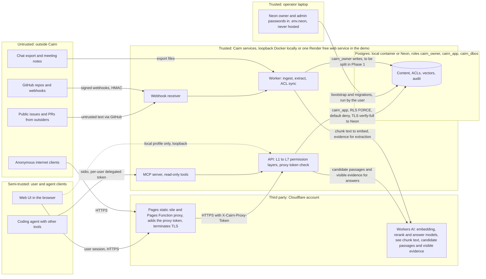

# Cairn threat model v1

Status: v1, written in Phase 0 on 27 Oct 2026 and updated on 3 Nov 2026 for the free-tier target (ADR-0013, ADR-0014, ADR-0015): TM-11 and TM-13 changed, TM-15 and TM-16 added. Source: section 15 of the [brainstorm](../brainstorm.md), with the permission layers from section 11 and the agent interface from section 14. Phase placement follows the [development plan](../development_plan.md). Labels follow the brainstorm: Proposed target, Estimate, Verify.

Nothing in this document describes behavior that exists yet, except the Phase 0 controls listed near the end. Every other threat has a named test that lands in a later phase. Until that test exists and passes, the mitigation is a design intent and not a guarantee.

## 1. Scope and assets

In scope: the Cairn services (receiver, worker, API, MCP server), their Postgres database, the hosted model calls (Cloudflare Workers AI for embeddings, reranking and answers), the free-tier hosting path (Cloudflare Pages and its Function, one Render web service, Neon Postgres), and the clients that talk to them (browser and coding agents). Out of scope for v1: the security of GitHub itself, of the hosting providers' own platforms, the host operating system, and any client tool that Cairn does not provide.

| Asset | Why it matters | Where it lives |
|---|---|---|
| Restricted source content | Private repos, private channels and meeting notes are the data the product must not leak | Postgres content tables, chunks |
| Derived claims and summaries | A claim built from hidden evidence can reveal that evidence | Postgres claim and support-set tables, caches |
| Embeddings | Inversion can recover text from vectors [R53], so they are as sensitive as the text | Postgres vector columns and indexes |
| ACL state | Wrong or stale ACLs turn every other control into a leak | Postgres ACL and membership tables |
| Audit log | Proves who asked what, and must not itself leak content | Postgres, IDs and hashes only |
| Secrets | GitHub App key, webhook secret, MCP tokens, Cloudflare API token (Workers AI only), proxy token, database passwords | Environment variables of each service, never the repo. In the demo: the app and DBOS passwords, the Cloudflare token and the proxy token in the Render environment and the proxy token as a Pages secret; the Neon owner and admin passwords in `.env.neon` on the operator's laptop only |

## 2. Actors

| Actor | Capability assumed | Main threats |
|---|---|---|
| Curious insider on the wrong team | Valid Cairn account, no access to the target source | Retrieval, derived and existence leaks, cache leak |
| Moved or departed employee | Had access earlier, lost it | Revocation lag, as-of queries used to regain old access |
| Outsider writing public issues or PRs | Can put text into public repos Cairn ingests | Indirect prompt injection, knowledge poisoning |
| Compromised agent client | Holds a valid delegated MCP token and runs other tools | MCP token misuse, bulk extraction, exfiltration through the client's other tools |
| Malicious dependency | Code runs inside a Cairn service or build | Supply chain, secrets theft |
| Operator error | Misconfigured role, deployment or log level | RLS bypass, LLM egress, secrets in logs, hosted secrets |
| Anonymous internet client | Can reach the public Pages and Render URLs and send any request volume | Free-tier exhaustion, probing of unauthenticated paths |

## 3. Trust boundaries

The boundaries that matter most:

- Everything entering from the left is untrusted text. It is stored as data and never executed as instructions (TM-06, TM-07).
- The database role used at runtime is not the owner and cannot bypass RLS. Phase 0 builds and tests this boundary (TM-11). On Neon the admin role (`neondb_owner`) keeps BYPASSRLS, so it is a laptop-only credential and no hosted process receives it.
- The hosted models sit outside the deployment. Workers AI receives every chunk text for embedding, the candidate passages for reranking and the packed evidence for answers. Only evidence the asker may see reaches the answer step (TM-13).
- Cloudflare, Render and Neon each hold part of the deployment: Cloudflare terminates TLS for the public site and relays requests, Render holds the runtime secrets in its environment, Neon holds the data. Their staff and platforms are outside Cairn's control (TM-15).
- Every path on the Render URL except `/healthz` needs the proxy token, which the Pages Function adds and which it strips from anything the client sent. The token keeps direct requests to the Render URL out. It is not user authentication, because the Function adds it for every caller of the public site, and the public internet can still spend the free allowances (TM-16).
- The agent client is outside Cairn's control. Cairn limits what it returns and what tools it offers, and cannot control what the client does next (see residual risks).

## 4. Threats and planned tests

Numbering follows the brainstorm section 15 and design section 16 exactly for TM-01 to TM-14. TM-15 and TM-16 come from the free-tier retarget design (section 16). Each threat has one test id. The planned test names are Proposed names, and the real names may change when the tests are written. The Phase column is the phase in which the test lands, not the phase in which the mitigation is first designed. Plan item numbers are in brackets.

| Test id | Threat | Vector | Mitigation | Planned test | Phase |
|---|---|---|---|---|---|
| TM-01 | Retrieval leak | Search returns restricted chunks | Layers L1 to L3: principal snapshot, ACL predicate in every query, RLS backstop | `test_canary_matrix_search_paths` (canary matrix, search paths) | 1 |
| TM-02 | Derived leak | Summary or claim built from hidden evidence | L5 claim-level projection, regenerated summaries, L7 keyed caches | `test_canaries_in_hidden_only_support_sets` [2.17] | 2 |
| TM-03 | Existence leak | Hidden counts, "1 result hidden", different not-found wording | No hidden counts, one not-found template | `test_not_found_reply_identical_with_and_without_hidden` [1.23] | 1 |
| TM-04 | Revocation lag | ACL event delayed or missed | ACL jobs in a priority queue, permission poll, L4 late recheck | `test_revocation_timing_p95` [3.18] | 3 |
| TM-05 | Cache leak | Cached answer served to another principal | Cache keys include the principal-set hash and the ACL version | `test_cross_persona_cache` [3.21] | 3 |
| TM-06 | Indirect prompt injection | Instructions inside issues, PRs or chat steer the model or the agent | Evidence as delimited data, no action tools, untrusted sources excluded by default | `test_injected_issue_scenario` [4.16] | 4 |
| TM-07 | Knowledge poisoning | Planted texts steer answers; five texts reached 90% attack success in PoisonedRAG [R54] | Trust tiers, untrusted labels, review for low tiers | `test_poisoned_doc_questions_c1` | 5 |
| TM-08 | Embedding inversion | Stolen vectors reveal text [R53] | Vectors get the same ACLs and purge rules as text | `test_deletion_purges_embeddings` [3.20] | 3 |
| TM-09 | Webhook forgery | Fake events | HMAC signature check, fetch on notify [R45] | `test_bad_webhook_signature_rejected` [3.16] | 3 |
| TM-10 | MCP token misuse | Stolen or over-broad token | Per-user delegated tokens, rate limits, audit; HTTP authorization per spec later [R43] | `test_mcp_token_scope` [4.17] | 4 |
| TM-11 | RLS bypass | Owner or BYPASSRLS role, integrity-check covert channels [R29]. On Neon the owner role `neondb_owner` has BYPASSRLS and cannot lose it | Non-owner role, FORCE, no foreign keys from less restricted tables into restricted ones. The Neon owner and admin credentials stay on the operator's laptop (`.env.neon`), are used only for bootstrap and migrations, and are never set on Render; runtime processes connect as `cairn_app` and `cairn_dbos` | `test_app_sees_zero_rows_without_a_policy`, `test_owner_sees_zero_rows_without_a_policy`, `test_app_cannot_disable_row_level_security` and `test_row_security_off_errors_instead_of_filtering` (role and default-deny test in `packages/core/tests/integration/test_roles.py`), `test_every_table_in_schema_cairn_enables_and_forces_rls` (schema invariant test) [0.17]; `test_admin_bypasses_rls_and_is_not_a_runtime_role` (managed-mode role test: the admin sees every row of a forced table); `test_no_admin_owner_or_superuser_credential_key` (Render Blueprint) | 0 |
| TM-12 | Cross-tenant leak | Shared index across tenants [R51] | Single tenant for the MVP, tenant key everywhere, partitioning later [R31] | `test_two_tenant_fixture` | 5 |
| TM-13 | LLM egress | Restricted text sent to a hosted model. Workers AI processes every chunk text (embedding), the candidate passages (rerank) and the packed evidence (answer) | Only visible evidence is sent to the answer step. Workers AI data terms are checked (FV10): Cloudflare states that Customer Content is not used to train models and that a standard request is not retained after the response, and Cairn uses no storage feature that would change that. Fakes are the default provider and CI has no Cloudflare token. The corpus is synthetic (D20) | `test_llm_payload_log_review` | 1 |
| TM-14 | Supply chain | Malicious package or model file | Pinned versions and hashes, minimal dependencies, dependency audit, secret scan, license check | `test_supply_chain_gates_in_ci` (`make audit secrets licenses`) | 0 |
| TM-15 | Hosting providers and hosted secrets | The Render environment holds the app and DBOS passwords, the Cloudflare token and the proxy token; Neon holds the data; Cloudflare terminates TLS for the public site. A provider breach, a leaked dashboard value or a secret committed to a deployment file exposes them | Least-privilege runtime roles (`cairn_app`, `cairn_dbos`; no owner or admin credential is hosted); the Cloudflare token is scoped to Workers AI; the proxy token gates every path except `/healthz` and is compared in constant time; TLS `verify-full` to Neon against the CA bundle in the image; `render.yaml` and `wrangler.toml` hold no secret value (`sync: false`) and gitleaks scans the tree; the edge webhook receiver holds only the insert-only `cairn_edge` credential (INSERT on the inbox, nothing else) and the webhook secret, both as Pages secrets ([ADR-0016](adr/ADR-0016-edge-webhook-receiver-and-drain-before-serve.md)) | `test_render_blueprint_has_no_secret_values` and `test_ft_app_environment_names_only_the_allowed_secrets` (the local `ft-app` container holds only the app and DBOS passwords and the proxy token, no admin or owner credential) | 0 |
| TM-16 | Free-tier exhaustion | A request flood spends the Pages Function requests, the Render instance hours, the Neon CU-hours or the Workers AI neurons, and the demo stops answering | `_routes.json` sends only `/api/*` through the Function, so static traffic spends no Function quota; the neuron budget guard refuses a call that would pass the daily cap; no keep-alive pinger, so idle time is not billed; the exhausted state shows as a 503 and never removes a control | `test_budget_never_admits_past_the_cap`; `test_routes_json_limits_functions_to_api` | 0 |

Notes on the table:

- The brainstorm lists the TM-01 test as "canary matrix, search paths". The canary matrix grows over later phases to the Estimate of 390 assertions (6 personas, 13 paths, 5 states). TM-01 is the part that covers search paths and lands first.
- TM-15 and TM-16 are Phase 0 rows because their controls and tests land with the free-tier retarget. They are checks of configuration and of the budget guard. Nothing in them is a live deployment test: the Render, Cloudflare and Neon steps are run by the user, and what only a live deploy can confirm is listed as FU items in [the deploy runbook](deploy.md).
- TM-14 has no single pytest function. Its test is the CI run of the audit, secret and license gates. The `test_` name above is a label for that gate and is Proposed.
- TM-07 and TM-12 land in Phase 5 because they need the evaluation corpus C1 and a second tenant fixture. Until then, TM-12 is covered only by the decision to run one tenant.
- TM-04 depends on a Proposed target: revocation p95 of 60 seconds or less, from the source event reaching Cairn to the content being unreachable on every path.

## 5. OWASP mapping

| OWASP item | Reference | Threats covered |
|---|---|---|
| LLM02:2025 Sensitive Information Disclosure | [R52] | TM-01 to TM-05, TM-13 and TM-15 |
| LLM08:2025 Vector and Embedding Weaknesses | [R51] | TM-07, TM-08 and TM-12 |
| Prompt injection | [R47], [R49] | Indirect prompt injection (TM-06) |

LLM08 advises permission-aware vector stores, partitioning, awareness of inversion and poisoning, and immutable logs. The Cairn design follows that advice through ACLs on vectors, a single tenant with a tenant key, purge rules, and an append-only audit record. References R29, R31, R43, R45, R47, R49, R51 to R54 are listed in section 21 of the brainstorm. The LLM02 reference [R52] was not re-fetched in the brainstorm research pass (Verify).

The lethal trifecta from [R47] (private data, untrusted content, external communication) applies to Cairn's MCP server. Cairn holds the first two, so it must never provide the third: its tools are read-only, fetch no URLs and send no messages.

## 6. Residual risks

These remain after every planned mitigation is in place.

- A client agent can still leak what Cairn legitimately returns. Cairn cannot control the client's other tools. If an agent has write or network tools and reads untrusted repos, content it was rightly given can leave through them. The setup docs warn about this pairing, and that warning is not a technical control.
- Zero observed leaks on a finite matrix is not proof. The canary matrix finds leaks on the paths and states it covers. It says nothing about paths nobody listed.
- The hosted models see the evidence they are sent. Workers AI receives every chunk text, every reranked passage and every packed evidence block, and anything a user may read can reach the answer model. Cloudflare's published terms (FV10, read 3 Nov 2026) say customer content is not used for training and standard requests are not retained, but the exact agreement of the operator's account is for the operator to confirm, and the repository depends on none of it. The corpus is synthetic (D20), so no real company data crosses that line today. A local model option would reduce the exposure at some cost in quality.
- Timing side channels are only partly tested. The not-found reply is identical in wording, but response time differences between "nothing exists" and "something hidden exists" are not fully measured.
- Public, untrusted sources can still mislead. Trust tiers and labels reduce the effect of poisoned text, and a determined outsider with a convincing document may still shift an answer until a reviewer catches it.
- Audit retention after a source deletion is an open question (brainstorm open question 14). The audit log keeps only IDs and hashes, and the retention rule is decided at the threat model review around 7 Nov.
- The local profiles have no authentication on `/healthz`, `/readyz` or the placeholder web page. The mitigation is loopback-only ports. In the demo deployment the proxy token protects only the direct Render URL: the Pages Function adds the token to every `/api/*` request it forwards, so anyone on the internet who reaches the Pages URL reaches every API path, including `/readyz` (which shows extension versions and the role name). The Phase 6 deployment review must add real authentication before any real data is loaded.
- Hosting providers are trusted with what they hold. A Render account compromise exposes the app and DBOS passwords, the Cloudflare token and the proxy token, and so the data that `cairn_app` can reach under RLS. A Neon account compromise exposes the data itself. A Cloudflare account compromise exposes the proxy token, the Workers AI traffic and the Pages deployment. The controls limit the blast radius (no owner credential hosted, a Workers AI-only token) and do not remove it.
- The free tiers can be exhausted by anyone who knows the public URL. The neuron guard, `_routes.json` and the absence of a keep-alive keep the damage to an unavailable demo and an unwanted bill of zero, but they cannot prevent the outage (TM-16). The Pages Function forwards every `/api/*` request with no authentication of its own, so a flood through the public site spends the Function allowance and wakes Render and Neon.
- In the local profiles the db-init step uses the superuser to bootstrap and the owner role to migrate. Both credentials exist only in the db and db-init containers. On Neon the same steps run from the operator's laptop with the Neon owner and admin passwords, which have BYPASSRLS and exist only in `.env.neon`. The ingest path will use a separate write role from Phase 1 (design open question OQ-2), so that the API role never gains write grants.

## 7. Phase 0 controls already active

Phase 0 builds no retrieval, so it enforces the base that later layers rely on. Each control names where it comes from. Whether a given control is implemented and passing at any moment is reported in `docs/evidence/phase-0/` and by `make gates`, and this document does not track that status.

| Control | What it does | Threats | Source of truth |
|---|---|---|---|
| Non-owner app role without BYPASSRLS | The API connects as `cairn_app`, which owns nothing, is not a superuser and belongs to no role | RLS bypass | Bootstrap (plan 0.5), design section 5 |
| Readiness refuses unsafe roles | `/readyz` returns 503 with `role_unsafe` if its own role is a superuser or has BYPASSRLS | RLS bypass | API (plan 0.7), design section 7 |
| FORCE RLS plus default deny test | A table with RLS enabled and forced, and no policy, returns zero rows to `cairn_app` and to `cairn_owner`; `ALTER TABLE ... DISABLE ROW LEVEL SECURITY` and `row_security = off` fail loudly | RLS bypass | Role and default-deny test (plan 0.17) |
| Schema invariant test | Fails if any table in schema `cairn` lacks enabled and forced RLS, so later migrations cannot add an unprotected table | RLS bypass, Retrieval leak | Integration tests (plan 0.15, 0.17) |
| Separate roles and databases | `cairn_dbos` owns only the DBOS database and has no access to content; each container receives only its own database password | RLS bypass | Bootstrap and compose (plan 0.4, 0.5) |
| Secrets from the environment | `.env` is ignored by version control, `.env.example` holds placeholders, `make env` generates random local values, `make env-update` only appends missing keys, SCRAM verifiers are sent for role passwords, logs redact secret-like keys and return error codes instead of exception text | LLM egress, Supply chain, Hosting providers and hosted secrets | Env generator, bootstrap, telemetry (plan 0.2, 0.5, 0.8) |
| Pinned dependencies | Direct dependencies pinned with `==` or exact versions, lock files with hashes, container images pinned by tag and digest, GitHub Actions pinned by commit SHA | Supply chain | Tooling and CI (plan 0.2, 0.3, 0.4, 0.9) |
| Dependency audit, secret scan, license check | `make audit`, `make secrets` and `make licenses` run in the gates and in CI; the license check also rejects Celery, Redis and Kombu | Supply chain | Task runner (plan 0.9, 0.15) |
| Loopback-only ports | Every published host port binds to 127.0.0.1, because nothing in the local profiles has authentication | Retrieval leak, MCP token misuse | Compose (plan 0.4) |
| Proxy token on every path but `/healthz` | When `CAIRN_PROXY_TOKEN` is set, the API answers an identical 404 to a missing or wrong `X-Cairn-Proxy-Token` header, compares in constant time and never logs the token; the Pages Function sets the header and drops any client-supplied copy | Hosting providers and hosted secrets, Free-tier exhaustion | API proxy-token check (task 5.2), Pages Function (FV7) |
| Runtime-only secrets on the hosted process | `render.yaml` and `wrangler.toml` hold no secret value (every secret-like key is `sync: false`), the Blueprint has no admin, owner or superuser key, and the `ft-app` container carries only the app and DBOS passwords and the proxy token | Hosting providers and hosted secrets, RLS bypass | Render Blueprint and freetier compose tests (plan 0.24) |
| TLS `verify-full` to Neon | The hosted process verifies the Neon server certificate against the CA bundle in the image (`sslrootcert=/etc/ssl/certs/ca-certificates.crt`; `system` loads no roots in the image, FV11) | Hosting providers and hosted secrets | Settings and Blueprint tests (FV11) |
| Neuron budget guard | A daily cap on Workers AI neurons, kept in Postgres; a call that would pass the cap is refused before it is made | Free-tier exhaustion, LLM egress | Budget guard (FT-22, ADR-0015) |
| `_routes.json` and no keep-alive | Only `/api/*` invokes the Pages Function; nothing keeps Render or Neon awake | Free-tier exhaustion | Pages configuration (FV7), ADR-0014 |
| Workers AI-only token, fakes by default | The Cloudflare token is scoped to Workers AI; the default providers are deterministic fakes, and CI has no Cloudflare token | LLM egress, Hosting providers and hosted secrets | `.env.example`, provider configuration (FT-23) |
| Hardened containers | Non-root users and read-only root filesystems where possible | Supply chain | Compose and Dockerfiles (plan 0.4) |
| Synthetic data only | The Kestrel Pay scenario uses fictional people, `.example` domains and generated canaries; no real company data exists in Phase 0, and no code path calls a model until Phase 1 (the Workers AI clients ship now and nothing invokes them) | LLM egress | Decision D20, scenario (plan 0.11) |
| Canary tokens and placement rules | Tokens are generated from a seed, and the validator checks that each canary appears only in sources within its allowed scopes | Retrieval leak, Derived leak | Scenario validator (plan 0.11, 0.12) |

The RLS fallback is already decided: if spike S2 shows that RLS blocks index use, retrieval moves to SECURITY DEFINER functions that apply the ACL join explicitly and are the only grant the app role has. RLS stays on for every other path. The decision is recorded in ADR-0006 on 30 Oct.

## 8. Review plan

- Phase 0: this document is checked by `make docs-check`, which requires every threat id once, with a planned test and a phase.
- Each phase that lands a test from section 4 updates the Phase column only if the test moves, and records the passing test in the phase evidence.
- A threat model review is scheduled around 7 Nov, which also settles audit retention after source deletion.
- Any new threat gets the next free TM number. Existing numbers are never reused, because tests and other documents cite them.
